# Prompts used

The assignment asks to share the prompts used. This file lists **every instruction I gave the AI assistant** while building this repository, in order, taken verbatim from the session transcript (Claude Code, one session on 2026-11-15, UTC times).

- **Original language:** I worked in Spanish. Each prompt is quoted exactly as typed, typos included, followed by an English translation. The long pasted prompts are kept verbatim in collapsible blocks with an English summary.
- **Nothing is reconstructed.** Every entry below exists word for word in the transcript. Messages that carried no instruction (`segui`, `continua`, a lone `A`) are listed as such, so the sequence is complete.
- **AI-drafted prompts:** two long pasted prompts were not typed from scratch. The Go backend task (#39) was iterated with Claude in a separate session. The final audit and README prompt (#52) came out of other Claude sessions. Both are marked where they appear.
- **What is not here:** the assistant's own messages, tool output and the internal instructions of the skills. The skills are described in [AI workflow](#ai-workflow) instead.
- **Redactions:** the commit e-mail address is replaced with `<author e-mail>`.

## Contents

- [AI workflow](#ai-workflow)
- [Prompt inventory](#prompt-inventory)
- [1. Bootstrap: requirements, architecture and scaffold](#1-bootstrap-requirements-architecture-and-scaffold)
- [2. Feature: basic operations](#2-feature-basic-operations)
- [3. Feature: optional operations, keypad and theme](#3-feature-optional-operations-keypad-and-theme)
- [4. Feature: Go backend with parity and backend selector](#4-feature-go-backend-with-parity-and-backend-selector)
- [5. Submission preparation](#5-submission-preparation)

## AI workflow

I did not ask for "a calculator app". I drove the work through two custom skills of my own that encode how I want an AI assistant to work on a codebase, plus the open-source [Superpowers](https://github.com/obra/superpowers) workflows they call.

| Skill | Role in this project | Invoked in |
|---|---|---|
| `start-project` (Project Bootstrap / Architecture) | Turns a requirement into project foundations: a question-by-question interview (name, type, stack, architecture, testing, Docker), an advisory review, a brainstorming pass with diagrams, then the scaffold, the `.ai/` documentation and ADR-001 | Phase 1 |
| `dev-skill` (Feature Development) | Orchestrates one feature: validates the project and its docs → classifies the change (MICRO/MEDIA/GRANDE) → spec → plan → ADR → implementation by subagents with a review per task → documentation checkpoint → verification (unit, lint, Docker, integration, regression, E2E) → optional final review | Phases 2, 3 and 4 |

Within `dev-skill`, the Superpowers workflows did the heavy lifting: `brainstorming` (design questions before any code), `writing-plans` (task plan with interfaces), `subagent-driven-development` (one implementer and one reviewer per task, then a whole-branch review), `test-driven-development` (RED → GREEN for every behavior) and `systematic-debugging`.

Every fork in the road came back to me as a multiple-choice question with a recommendation; I chose, and the choices are recorded below as **decisions**. Every spec and plan was opened for me to read and needed my explicit approval before the next step. No commit, push or PR happened without my approval, and every PR was merged by me.

```mermaid
flowchart LR
    R[Requirement] --> SP["start-project<br/>interview · advisory · brainstorming"]
    SP --> SC["Scaffold + .ai/ docs + ADR-001<br/>PR #1"]
    SC --> DS{{"dev-skill (per feature)"}}
    DS --> V[Validate project + docs]
    V --> C[Classify change]
    C --> S["Spec → approved by me"]
    S --> P["Plan → approved by me"]
    P --> A[ADR]
    A --> I["Subagents: TDD per task<br/>+ review per task"]
    I --> D[Docs checkpoint]
    D --> VE["Verification: unit · lint · Docker · E2E"]
    VE --> RV[Whole-branch review]
    RV --> PR["Commit + PR → merged by me<br/>PR #2 · #3 · #4"]
    PR -.next feature.-> DS
```



| Phase | Result | ADR |
|---|---|---|
| Bootstrap | Monorepo, Java hexagonal skeleton, React feature-based skeleton, Docker, CI, `.ai/` docs — PR #1 | ADR-001 |
| Basic operations | `add`, `subtract`, `multiply`, `divide` end to end, strict contract, E2E — PR #2 | ADR-002 |
| Optional operations | `power`, `sqrt`, `percentage`, 4×6 keypad, dark/light theme — PR #3 | ADR-003 |
| Go backend | Go implementation with byte-exact parity, backend selector, health fallback — PR #4 | ADR-004 |
| Submission | `backend/java` + `backend/go` layout, Go as default backend, README and this file | ADR-005 |

## Prompt inventory

Type: **prompt** = a message I sent; **mid-turn** = a message I sent while the assistant was working; **decision** = my answer to a multiple-choice question the assistant asked (the options were proposed by the assistant, the choice is mine).

| # | UTC | Phase | Type | Instruction (English) |
|---|---|---|---|---|
| 1 | 05:18 | Bootstrap | prompt (`/start-project`) | Create `sezzle-calculator` from the assignment; start with a Java backend, Go later |
| 2 | 05:18–05:21 | Bootstrap | decisions | Name, purpose, full-stack, React + TS / Java, hexagonal + feature-based, strict TDD, Docker + compose, no ticket |
| 3 | 05:22 | Bootstrap | decision (free text) | Node 22 LTS, not 26; revisit frontend architecture; add integration and E2E tests |
| 4 | 05:23–05:29 | Bootstrap | decisions | Feature-based + atomic UI, Spring Boot 4.1, React 19.3, CSS Modules, single generic endpoint, BigDecimal, "a % of b", keypad + physical keyboard |
| 5 | 05:28 | Bootstrap | mid-turn | Bootstrap only the basic operations; optional ones later with `dev-skill` |
| 6 | 05:29 | Bootstrap | prompt | "Yes, let's continue" |
| 7 | 05:31–05:41 | Bootstrap | decisions | Playwright, 90% coverage gate, Palantir Java Format, GitHub Actions, fnm, TypeScript 6.0.3 |
| 8 | 05:37 | Bootstrap | mid-turn | "And? Let's go on" |
| 9 | 05:49 | Bootstrap | prompt | Public GitHub repo, initial commit under my name only, show me commit and message first |
| 10 | 05:52 | Bootstrap | decision | GitHub account and commit e-mail |
| 11 | 05:56 | Bootstrap | prompt | Use a branch and a PR; I approve and merge |
| 12 | 05:58 | Bootstrap | decision | Execute: empty commit on main, scaffold branch, PR #1 |
| 13 | 06:03 | Basic ops | prompt (`dev-skill`) | Implement the 4 basic operations with their ADR; optional ones in a second iteration |
| 14 | 06:05–06:08 | Basic ops | decisions | GRANDE; JSON numbers with limits; chain like a physical calculator; negative numbers like Windows (`±`) |
| 15 | 06:10 | Basic ops | prompt | "Let's move on" |
| 16 | 06:11 | Basic ops | prompt | Option A; Lombok (MapStruct only if needed); records, since it is Java 21 |
| 17 | 06:13 | Basic ops | prompt | Open the spec in Chrome |
| 18 | 06:15 | Basic ops | decisions | Strict contract; spec approved |
| 19 | 06:17 | Basic ops | mid-turn | Maven or Gradle, and why? |
| 20 | 06:19 | Basic ops | decisions | Keep Maven; plan approved |
| 21 | 06:39 | Basic ops | prompt | Run the E2E and open the app in my Chrome meanwhile |
| 22 | 06:53 | Basic ops | prompt | Tell me when it finishes so we commit and open the PR |
| 23 | 07:02 | Basic ops | prompt | Also verify that Swagger works |
| 24 | 07:16 | Basic ops | decisions | No extra review; commit + push + PR #2 |
| 25 | 07:21 | Optional ops | mid-turn (`dev-skill`) | Add the optional operations with ADR-003; new buttons directly on the keypad, no "more" menu |
| 26 | 07:22–07:24 | Optional ops | decisions | GRANDE; 4×6 Windows-style keypad; "Invalid operand" title; power result capped at 100 integer digits |
| 27 | 07:26 | Optional ops | prompt | Do we have a pseudo Strategy pattern for operations in Java? |
| 28 | 07:27 | Optional ops | prompt | "A" (generalize the enum Strategy) |
| 29 | 07:30–07:32 | Optional ops | decisions | Spec and plan approved |
| 30 | 07:38 | Optional ops | prompt | "Go on" |
| 31 | 07:44 | Optional ops | prompt | Why do operation keys have different colors? |
| 32 | 07:45 | Optional ops | decision | All operation keys the same color |
| 33 | 07:50 | Optional ops | prompt | Open it in Chrome so I can try it |
| 34 | 07:52 | Optional ops | prompt | Add a dark/light theme button, dark by default |
| 35 | 07:53 | Optional ops | decision | Toggle at the top right of the page |
| 36 | 07:56 | Optional ops | prompt | Continue; turn off auto mode, I enabled it by accident |
| 37 | 07:57 | Optional ops | decision | Launch a new subagent to continue the stopped theme task |
| 38 | 08:17 | Optional ops | decisions | No extra review; commit + push + PR #3 |
| 39 | 08:22 | Go backend | prompt (`dev-skill`) | Pasted task, iterated with me in a separate Claude session: second backend in Go with full parity, backend selector, three-service Docker Compose, tests, docs |
| 40 | 08:23–08:27 | Go backend | decisions | GRANDE; URL-prefix routing; own decimal package on `math/big`; segmented `Java \| Go` switch; selection not persisted |
| 41 | 08:30 | Go backend | prompt | Looks good, continue; Go must have its Swagger too |
| 42 | 08:42 | Go backend | mid-turn | If a backend is unhealthy on load, hide the selector and silently use the working one; handle busy Docker ports |
| 43 | 08:44 | Go backend | decisions | Silent failover; script that picks free ports |
| 44 | 08:48 | Go backend | mid-turn | Open the spec in Chrome |
| 45 | 08:49–08:52 | Go backend | decisions | Re-check and return automatically; spec and plan approved |
| 46 | 17:48 | Go backend | prompt | "Continue" |
| 47 | 19:13 | Go backend | prompt | Take screenshots for the README and the PR |
| 48 | 19:57 | Go backend | mid-turn | Which version is deployed on :3000? I don't see the Go/Java switch |
| 49 | 19:57 | Go backend | decision | Replace my running stack with the new version |
| 50 | 20:00 | Go backend | mid-turn | Pasted breaking-change alert: "tackle this" (make the renames backward compatible) |
| 51 | 20:10 | Go backend | decisions | No extra review; commit + push + PR #4 |
| 52 | 20:20 | Submission | prompt | Pasted assignment + an AI-drafted audit prompt (other Claude sessions): evaluate it and propose a plan |
| 53 | 20:24 | Submission | decisions | Go as default backend; interview notes outside the repo; English summary of the ADRs |
| 54 | 20:24 | Submission | mid-turn | I want to review the prompts file before it is pushed; restructure into `backend/java` and `backend/go` |
| 55 | 20:25 | Submission | mid-turn | The README must also cover Swagger and explain the tests, E2E, etc. |

## 1. Bootstrap: requirements, architecture and scaffold

### #1 · 05:18 · prompt · skill `start-project`

> Necesito, dentro de la carpeta downloads/ia, crear una nueva carpeta llamada sezzle-calculator, y alli iniciaremos todo el proceso con este requerimiento *[assignment text pasted verbatim, see below]* . Lo unico que cambiaremos, es que iniciaremos con un backend en java, mas adelante, con otro prompt y otra sesion, lo hare en GO

**English:** "Inside downloads/ia, create a new folder called sezzle-calculator, and we will start the whole process there with this requirement *[assignment]*. The only thing we will change is that we will start with a Java backend; later, with another prompt and another session, I will do it in Go."

<details>
<summary>Assignment text as pasted</summary>

````text
Build a full-stack calculator application with a React frontend and a backend microservice. The frontend should consume the backend API to perform basic and advanced arithmetic operations. Focus on clean design, maintainable code, and testable architecture.Requirements
Functional
Operations:
Addition, Subtraction, Multiplication, Division
Optional: Exponentiation, Square Root, Percentage
Frontend (React):
Intuitive UI for entering input and displaying results
Input validation and error handling
Responsive design (basic mobile support)
Backend (REST API):
Expose endpoints for calculator operations
Validate input and handle edge cases (division by zero, invalid data)
Return results in JSON format
Non-Functional
Clean, readable, and idiomatic code (frontend and backend)
Unit tests covering key functionality for both layers
Documentation: setup instructions, API usage, and design rationale
Optional: Dockerfile for full-stack deployment
Constraints
Frontend: React (TypeScript preferred)
Backend: Go is perferred
Deliverables
Git repository with frontend and backend code
README with setup instructions, API examples, and design decisions
Unit tests and coverage report
Optional: Dockerfile to run frontend + backend together
````

</details>

### #2 · 05:18–05:21 · decisions

| Question (translated) | My choice |
|---|---|
| Project name | `sezzle-calculator` |
| Purpose in one sentence | "Calculadora fullstack con operaciones básicas y avanzadas" (full-stack calculator with basic and advanced operations) |
| Project type | Full-stack |
| Stack (the assignment prefers Go; you said Java first) | Frontend React + TypeScript, backend Java |
| Architecture | Backend: hexagonal (ports & adapters). Frontend: feature-based folders |
| Testing strategy | Strict TDD (RED → GREEN → refactor) |
| Docker | Dockerfile + docker-compose |
| Ticket reference | None |
| Advisory review | Understood, continue |

### #3 · 05:22 · decision (free-text answer to "Do you confirm the foundations?")

> CONFIRMO LAS FUNCIONALIDADES, Y EN EL PASO ANTERIOR, ME GUSTARIA TOMAR LA NOTA, DE NO USAR NODE 26 UY SI USAR EL 22 QUE ES LTS. RELACIONADO A LAS FUNCIONALIDADES, ME GUSTARIA REPASAR LA ARQUITECTURA DEL FRONTEND, PREGUNTAME LAS OPCIONES POSIBLES. YT RELACIONADO AL TESTING, APARTE DEL TDD ME GUSTARIAN PRUEBAS INTEGRALES Y E2E CUANDO ESTE FRONT Y BACK LISTOS, PROBANDO CASOS DE EXITO DE ERROR Y BORDERS

**English:** "I confirm the features. About the previous step, note: do not use Node 26, use 22, which is LTS. I would like to revisit the frontend architecture — ask me the possible options. And on testing: besides TDD I want integration and E2E tests once front and back are ready, covering success, error and edge cases."

### #4 · 05:23–05:29 · decisions

| Question (translated) | My choice |
|---|---|
| Frontend architecture | Feature-based with atomic design inside each feature |
| Confirm final foundations | Confirm, continue to brainstorming |
| Spring Boot version | 3.4.x — then, after the assistant checked Maven Central and found 3.4 out of open-source support: **4.1.x** |
| React version (the summary said 18; the current one is 19.3.1) | React 19.3 |
| Styling | CSS Modules |
| Endpoint design (the Go backend will have to follow the same contract) | One generic endpoint: `POST /api/v1/calculate` with `{"operation", "operands"}` |
| Numeric type (with `double`, 0.1 + 0.2 = 0.30000000000000004) | `BigDecimal` |
| Meaning of "percentage" | a % of b |
| Input method | On-screen keypad + physical keyboard |

### #5 · 05:28 · mid-turn

> Hagamos lo siguiente, en este primera etapa que estamos haciendo el start project, haremos las operaciones basicas. LKuego ejecutare otra skill lavada dev/skill donde agregare las operaciones opcionales, que te parece?

**English:** "Let's do this: in this first stage, the start-project one, we'll do the basic operations. Then I'll run another skill called dev-skill where I'll add the optional operations. What do you think?"

### #6 · 05:29 · prompt

> SI, CONTINUEMOS

**English:** "Yes, let's continue."

### #7 · 05:31–05:41 · decisions

| Question (translated) | My choice |
|---|---|
| E2E tool (real front and back; success, error and edge cases) | Playwright 1.65 |
| Minimum coverage (the build fails below it) | 90% |
| Java code style (enforced by Spotless) | Palantir Java Format |
| CI | GitHub Actions |
| How to run Node 22 (the machine had Node 26 and no version manager) | Install fnm with Homebrew |
| Brainstorming closed: Spring Boot 4.1.2 + React 19.3, `POST /api/v1/calculate`, BigDecimal, 4 basic operations, 90% coverage, Playwright, GitHub Actions; diagrams in `.ai/diagrams/` | Confirm, continue to scaffold |
| Conflict: typescript-eslint supports TypeScript < 6.1 only | TypeScript 6.0.3 |

### #8 · 05:37 · mid-turn

> y? Sigamos

**English:** "And? Let's go on."

### #9 · 05:49 · prompt

> Cuando temrines, vamos a crear el proyecto en mi github, y subir el commit inicial, el repo debe ser publico y no debe salir el coauthored, solo mi nombre. Nistrarme lo que va en el commit y el mensaje nates de hacerlo obvio

**English:** "When you finish, we'll create the project on my GitHub and push the initial commit. The repo must be public and no co-author line may appear, only my name. Obviously, show me what goes into the commit and the message before doing it."

### #10 · 05:52 · decision

| Question (translated) | My choice |
|---|---|
| GitHub account for the public repo | `pabloandresgallardo` |
| Commit e-mail (it will be public in the history) | `<author e-mail>` |

### #11 · 05:56 · prompt

> Si, vamos GO. Igual mejor crea una rama, y hace el PR de esa rama a main, yo mismo lo apruebo y mergeo

**English:** "Yes, go. But better create a branch and open a PR from it to main; I'll approve and merge it myself."

### #12 · 05:58 · decision

| Question (translated) | My choice |
|---|---|
| Empty commit on `main`, scaffold on `chore/initial-scaffold`, public repo, PR to `main` (you merge) | Yes, execute |

## 2. Feature: basic operations

### #13 · 06:03 · prompt · skill `dev-skill`

> Listo, ahora vamos a seguir, usando la skill dev-skill, con ella haremos la implementacion de las operaciones basicas Addition, Subtraction, Multiplication, Division (Asegurarse que se guarde el adr correspondiente), luego en una segunda iteracion agregaremos  estas Optional: Exponentiation, Square Root, Percentage, pero inciiemos con las bases

**English:** "Done. Now let's continue using the dev-skill skill: with it we'll implement the basic operations Addition, Subtraction, Multiplication, Division (make sure the corresponding ADR is saved); then, in a second iteration, we'll add the optional Exponentiation, Square Root, Percentage — but let's start with the basics."

### #14 · 06:05–06:08 · decisions

| Question (translated) | My choice |
|---|---|
| Classification: GRANDE (first implementation of the public contract, two services, E2E) | Confirm GRANDE |
| How operands travel and their limits (defines validation in both layers and in the future Go backend) | JSON numbers with limits |
| How the calculator chains operations (each binary operation is one API call) | Chain like a physical calculator |
| How the user enters a negative number | Free text: "Si hacerlo como el 1, como lo hace windows. el usuario puede usar el teclado fisico o el virtual de la calculadora" — *"Yes, do it like option 1, the way Windows does it; the user can use the physical keyboard or the calculator's on-screen one"* |

### #15 · 06:10 · prompt

> Avanzamos

**English:** "Let's move on."

### #16 · 06:11 · prompt

> Me gusta el A, usar lombok y si es necesario mapstruct. Tambien intentar usar record si llegan a sumar, ya que estamos en java 21

**English:** "I like A. Use Lombok, and MapStruct if needed. Also try to use records where they add value, since we're on Java 21."

### #17 · 06:13 · prompt

> ABRILO EN CHROME ASI L OLEO

**English:** "Open it in Chrome so I can read it."

### #18 · 06:15 · decisions

| Question (translated) | My choice |
|---|---|
| How strict is the backend with almost-valid requests (`"ADD"`, unknown fields)? The Go backend must replicate it | Strict |
| Spec `.ai/docs/specs/2026-11-15-basic-operations.md` | Approve, continue to the plan |

### #19 · 06:17 · mid-turn

> Usaremos maven o gradle y porque?

**English:** "Will we use Maven or Gradle, and why?"

### #20 · 06:19 · decisions

| Question (translated) | My choice |
|---|---|
| Maven or Gradle (the scaffold used Maven, chosen without asking you) | Keep Maven |
| Plan `.ai/docs/plans/2026-11-15-basic-operations.md` | Approve, start implementation |

### #21 · 06:39 · prompt

> Si ya estas por inciar el E2E, hazlo, pero en paralelo abrilo en mi chrome asi lo voy viendo

**English:** "If you're about to start the E2E, do it, but in parallel open it in my Chrome so I can watch."

### #22 · 06:53 · prompt

> avisame cuando termine así hacemos el commit y el PR

**English:** "Tell me when it finishes so we make the commit and the PR."

### #23 · 07:02 · prompt

> Okay, tambien valida que tengamos el swagger funcionando

**English:** "Okay, also verify that Swagger is working."

### #24 · 07:16 · decisions

| Question (translated) | My choice |
|---|---|
| Run one more reviewer? (8 per-task reviews and a whole-branch review already ran; the latter found and fixed a DoS) | No, finish |
| Commit `feat: implement basic arithmetic operations end to end`, push and PR to `main` | Yes, commit + push + PR |

## 3. Feature: optional operations, keypad and theme

### #25 · 07:21 · mid-turn · skill `dev-skill`

> Listo, quiero que ahora vuelvas a usar la dev-skill pero ahora para agregar Optional: Exponentiation, Square Root, Percentage
>  , me parece bien qeu tengase el ADR-003 y tambien me aprece improtante que los botones de las nuevas operaciones aparezcan directamente en la calculadora, que no deba usar un boton para ver mas operaicones, eso no, directamente agregar los botones nuevos

**English:** "Done. Now use dev-skill again, this time to add the optional Exponentiation, Square Root, Percentage. Having ADR-003 is fine, and it's important to me that the new operation buttons appear directly on the calculator — no button to show more operations, none of that; just add the new buttons."

### #26 · 07:22–07:24 · decisions

| Question (translated) | My choice |
|---|---|
| Classification: GRANDE (extends the contract with 3 operations and variable arity) | Confirm GRANDE |
| Keypad layout with √, xʸ, % (19 → 22 buttons) | 4×6, Windows style, `=` spanning two rows |
| Error for √(−4) or 2 ^ 0.5 (the title is part of the contract) | New title `Invalid operand` |
| Limit the size of a `power` result (999999999999999^1000 has 15,000 digits) | Up to 100 integer digits |

### #27 · 07:26 · prompt

> Estamos bien, avanzamos. Algo que me gustaria entender, en java para el tipo de operaciones y demas, tenemos un pseudo strategy implementado?

**English:** "We're fine, let's move on. Something I'd like to understand: in Java, for the operation types and so on, do we have a pseudo Strategy pattern implemented?"

### #28 · 07:27 · prompt

> A

**English:** Option A — make the enum a full Strategy (`apply`, `arity`, `validate` per operation).

### #29 · 07:30–07:32 · decisions

| Question (translated) | My choice |
|---|---|
| Spec `.ai/docs/specs/2026-11-15-optional-operations.md` | Approve, continue to the plan |
| Plan `.ai/docs/plans/2026-11-15-optional-operations.md` | Approve, start implementation |

### #30 · 07:38 · prompt

> segui

**English:** "Go on."

### #31 · 07:44 · prompt (with a screenshot of the keypad)

> [Image #5] Cual es la idea de que los botones de operaciones tengan distintos colores?

**English:** "What's the idea behind operation buttons having different colors?"

### #32 · 07:45 · decision

| Question (translated) | My choice |
|---|---|
| Button colors (today: blue = waits for another number, gray = acts immediately, so √ is gray and xʸ blue) | All operation keys the same color |

### #33 · 07:50 · prompt

> abrime en chrome asi voy probando tmb

**English:** "Open it in Chrome for me so I can try it too."

### #34 · 07:52 · prompt

> Perfecto, agregar tambien que el front tenga un boton para modo oscuro y modo claro, que se abra el modo oscuro por defecto

**English:** "Perfect. Also add a dark/light mode button to the frontend; it should open in dark mode by default."

### #35 · 07:53 · decision

| Question (translated) | My choice |
|---|---|
| Where the theme button goes | Top right of the page |

### #36 · 07:56 · prompt

I stopped a running subagent by accident, then sent:

> Continua, DESACTIVA EL AUTO MODE QUE SIN QUERER LO PRENDI

**English:** "Continue. TURN OFF AUTO MODE, I ENABLED IT BY ACCIDENT."

### #37 · 07:57 · decision

| Question (translated) | My choice |
|---|---|
| The theme subagent was stopped and cannot be resumed; it left the theme module and toggle with tests. How to continue? | Launch a new one that continues |

### #38 · 08:17 · decisions

| Question (translated) | My choice |
|---|---|
| Run one more reviewer? (6 per-task reviews, a whole-branch review and a re-review of its fixes already ran) | No, finish |
| Commit `feat: add power, square root and percentage with dark/light theme`, push and PR to `main` | Yes, commit + push + PR |

## 4. Feature: Go backend with parity and backend selector

### #39 · 08:22 · prompt · skill `dev-skill`

> Necesito que uses la dev-skill para esto *[long task pasted, below]*

**English:** "I need you to use dev-skill for this:"

**Where it came from:** I wrote this task back and forth with Claude in a separate session, refining it until it said what I wanted, and then pasted it here. It is AI-assisted text, not typed from scratch.

**Summary of the pasted task (not a full translation):** add a second backend in Go **without removing or replacing Java**, with full functional parity and the same API contract. Analyze the whole repository (Java, frontend, docs, ADRs) before writing code, with Java as the behavioral reference. Use the Superpowers workflows for real (brainstorming, plan, TDD, debugging, code review) and a "DB Skill" (only if persistence were needed). Add a compact selector at the top right, **Java by default**, with request routing centralized in the HTTP client and no reload when switching. `docker compose up --build` must start frontend + Java + Go, solving how the browser reaches the containers. Tests: Go unit tests, a Java-vs-Go parity suite, frontend selector tests, and Docker validation from a clean start. Docs and a new ADR, and a structured final report.

> **Later change:** the pasted task required Java as the default backend. In phase 5 I changed that to Go (#53), because the assignment states that Go is preferred.

<details>
<summary>Pasted task, verbatim (Spanish)</summary>

````markdown
# TAREA: Implementar un segundo backend en Go manteniendo el backend existente en Java

## 1. Contexto y objetivo

Actualmente existe un proyecto de calculadora que ya cuenta con:

- Un backend desarrollado en Java, con las operaciones básicas y avanzadas implementadas.
- Un frontend funcional.
- Documentación del proyecto.
- Guías de implementación.
- Documentos de decisiones arquitectónicas (ADDs / ADRs).
- Estructura y lineamientos de desarrollo ya definidos.

El objetivo es incorporar una segunda implementación del backend utilizando Go, sin eliminar ni reemplazar el backend actual en Java.

La aplicación debe permitir que el usuario seleccione desde el frontend qué backend utilizar para procesar las operaciones de la calculadora.

Existirán dos alternativas:

- **Java:** backend seleccionado por defecto.
- **Go:** nueva implementación del backend.

Ambos backends deben ofrecer exactamente las mismas funcionalidades y respetar el mismo contrato de API.

Esto es una extensión del proyecto existente, no una reescritura.

## 2. Primera etapa obligatoria: análisis completo del repositorio

Antes de modificar cualquier archivo o comenzar a desarrollar en Go, es obligatorio realizar una investigación completa del proyecto existente.

No comenzar directamente con la implementación.

### 2.1. Exploración del repositorio

Inspeccionar la estructura completa del repositorio, incluyendo:

- Código fuente de Java.
- Código fuente del frontend.
- Tests existentes.
- Dockerfiles.
- Docker Compose.
- Archivos de configuración.
- Carpetas de documentación.
- Documentación arquitectónica.
- Guías de implementación.
- Todos los archivos Markdown (`.md`) relevantes.
- Todos los ADDs / ADRs o documentos equivalentes.

No asumir que toda la documentación está concentrada en una única carpeta.

Buscar en todo el repositorio los documentos que puedan contener decisiones, restricciones o instrucciones relevantes.

### 2.2. Análisis del backend Java

Comprender detalladamente la implementación existente.

Identificar:

- Punto de entrada de la aplicación.
- Framework y dependencias.
- Estructura de paquetes.
- Controllers y endpoints.
- Services y lógica de negocio.
- Modelos de dominio.
- DTOs.
- Contratos de request y response.
- Operaciones matemáticas básicas.
- Operaciones matemáticas avanzadas.
- Validaciones.
- Manejo de errores.
- Precisión numérica.
- Representación de números.
- Comportamiento de redondeo.
- Casos límite.
- Tests unitarios y de integración.
- Configuración y variables de entorno.

La implementación Java será la referencia funcional y de comportamiento para desarrollar la versión en Go.

No inventar reglas de negocio ni simplificar funcionalidades existentes.

### 2.3. Análisis del frontend

Comprender cómo se comunica actualmente el frontend con Java.

Identificar:

- Cliente HTTP o capa de servicios API.
- Configuración de endpoints.
- Estructura de requests y responses.
- Manejo de errores.
- Estados de carga.
- Arquitectura de componentes.
- Convenciones visuales existentes.
- Diseño responsive.

Determinar cuál es la forma más limpia de incorporar la selección del backend sin duplicar la lógica del frontend.

### 2.4. Análisis de documentación y decisiones arquitectónicas

Leer toda la documentación relevante, incluyendo cada archivo `.md` y ADD aplicable.

Extraer:

- Restricciones arquitectónicas.
- Convenciones de nombres.
- Estándares de código.
- Patrones de diseño.
- Expectativas de testing.
- Requisitos de despliegue.
- Decisiones tecnológicas.
- Restricciones explícitas.

Las decisiones arquitectónicas existentes deben considerarse autoritativas, salvo que exista una justificación documentada para proponer un cambio.

Antes de implementar, generar un plan concreto basado en los hallazgos.

## 3. Uso obligatorio de Superpowers

Es obligatorio utilizar la skill Superpowers durante todo el desarrollo.

No simular su utilización ni limitarse a mencionar que fue utilizada.

Leer sus instrucciones reales y seguir los workflows correspondientes.

Aplicar especialmente los siguientes procesos:

1. Exploración del repositorio antes de implementar.
2. Definición de la estrategia de implementación.
3. División del trabajo en tareas manejables.
4. Identificación de dependencias entre tareas.
5. Implementación incremental.
6. Desarrollo guiado por tests (TDD).
7. Validación de cada etapa.
8. Revisión final del código.

Utilizar los workflows de Superpowers que correspondan para:

- Brainstorming y diseño.
- Elaboración del plan de implementación.
- Test-Driven Development.
- Debugging sistemático.
- Code Review.

Si alguna funcionalidad necesaria de Superpowers no está disponible, informar la limitación en lugar de afirmar que se utilizó.

## 4. Uso obligatorio de DB Skill

También es obligatorio utilizar la skill DB Skill.

Leer sus instrucciones reales y aplicar todos los lineamientos correspondientes.

Primero analizar la arquitectura existente antes de decidir si es necesario realizar cambios relacionados con bases de datos.

No incorporar una base de datos simplemente porque existe esta skill.

Si la calculadora actualmente no necesita persistencia, conservar esa decisión arquitectónica.

Si existe funcionalidad relacionada con persistencia, asegurar que la implementación en Go respete la arquitectura, convenciones y restricciones actuales de la base de datos.

## 5. Implementación del backend en Go

Desarrollar un backend completo en Go que reproduzca las funcionalidades del backend Java existente.

### 5.1. Paridad funcional

Todas las operaciones soportadas por Java deben estar disponibles también en Go.

Esto incluye:

- Todas las operaciones básicas.
- Todas las operaciones avanzadas.
- Todas las validaciones.
- Todos los escenarios de error.
- Todas las reglas de negocio existentes.

Ambas implementaciones deben producir resultados equivalentes para los mismos requests.

Prestar especial atención a:

- Precisión de punto flotante.
- Manejo de enteros y decimales.
- División por cero.
- Entradas inválidas.
- Números negativos.
- Valores grandes.
- Redondeos.
- Casos matemáticos extremos.

No asumir que el comportamiento numérico predeterminado de Go coincide automáticamente con Java.

Investigar y reproducir explícitamente el comportamiento existente.

### 5.2. Arquitectura

Respetar los lineamientos arquitectónicos identificados en el repositorio.

Utilizar Go idiomático y mantener una separación clara de responsabilidades.

Evitar complejidad innecesaria, sobreingeniería y duplicación de lógica.

La implementación debe ser mantenible, testeable y consistente con las decisiones documentadas.

No introducir abstracciones sin una justificación arquitectónica clara.

### 5.3. Compatibilidad de API

El backend Go debe implementar exactamente el mismo contrato de API que Java.

Mantener:

- Métodos HTTP.
- Rutas de endpoints.
- Formatos de requests.
- Formatos de responses.
- Códigos HTTP.
- Estructura de errores.
- Comportamiento de validaciones.

El frontend no debe necesitar implementar diferentes mecanismos de comunicación según el backend seleccionado.

Si se detectan inconsistencias en la API Java existente, documentarlas y proponer una solución antes de modificar los contratos actuales.

## 6. Frontend: selector de backend

Incorporar un selector de backend en el frontend existente.

### 6.1. Requisitos visuales

Agregar un selector compacto en la esquina superior derecha de la aplicación.

Debe permitir elegir entre:

- Java.
- Go.

**Java debe estar seleccionado por defecto.**

El selector debe ser intuitivo y mantener coherencia visual con el diseño actual.

Puede implementarse como un dropdown o un switch compacto, según las convenciones existentes del frontend.

### 6.2. Enrutamiento de requests

El backend seleccionado debe determinar dónde se envían las operaciones de la calculadora.

Comportamiento esperado:

- Si está seleccionado Java, todos los requests se envían al backend Java.
- Si está seleccionado Go, todos los requests se envían al backend Go.

Reutilizar la arquitectura existente del cliente HTTP siempre que sea posible.

Evitar duplicar lógica de negocio o desarrollar dos implementaciones diferentes de la calculadora en el frontend.

La selección del backend debería centralizarse en el cliente HTTP o en la capa de servicios API.

### 6.3. Experiencia de usuario

La selección debe permanecer visible.

Cambiar de backend no debe requerir recargar la aplicación.

La calculadora debe continuar funcionando normalmente después de cambiar la selección.

Los indicadores de carga, resultados y manejo de errores deben comportarse de manera consistente independientemente del backend seleccionado.

## 7. Docker Compose

Actualizar la configuración de Docker para que un único comando construya e inicie los tres componentes de la aplicación:

1. Frontend.
2. Backend Java.
3. Backend Go.

La arquitectura esperada debe permitir ejecutar:

```bash
docker compose up --build
```

Este comando debe construir e iniciar los tres servicios.

### Requisitos

- Conservar la configuración Docker existente de Java.
- Crear un Dockerfile para Go.
- Reutilizar el Dockerfile del frontend cuando sea posible.
- Configurar correctamente la red de Docker.
- Evitar conflictos de puertos.
- Configurar correctamente las variables de entorno.
- Implementar health checks cuando corresponda.
- Utilizar nombres de servicios para la comunicación interna entre contenedores.
- Asegurar que el frontend pueda comunicarse con ambos backends.
- Evitar direcciones específicas del entorno hardcodeadas en el código.

**Importante:** analizar cómo se comunica el navegador con los servicios Docker.

Si el frontend se ejecuta en el navegador del usuario, no asumir que puede resolver nombres internos de servicios como `java-backend` o `go-backend`.

Resolver correctamente esta comunicación mediante proxy, configuración de URLs públicas u otra alternativa coherente con la arquitectura existente.

La aplicación completa debe funcionar cuando se levanta mediante Docker Compose.

Documentar puertos, variables de entorno y comandos de inicio.

## 8. Estrategia de testing

El testing es una parte fundamental de esta tarea.

### 8.1. Tests de Go

Crear tests completos para:

- Operaciones básicas.
- Operaciones avanzadas.
- Entradas válidas.
- Entradas inválidas.
- Casos límite.
- Manejo de errores.
- Respuestas de API.

### 8.2. Tests de paridad entre Java y Go

Comparar el comportamiento de ambas implementaciones.

Para una misma entrada, ambos backends deben producir resultados equivalentes y respuestas de error compatibles.

Siempre que sea posible, crear casos de prueba compartidos o una suite que pueda ejecutarse contra ambos backends.

No limitar la validación a unos pocos casos exitosos.

### 8.3. Tests del frontend

Verificar:

- Java está seleccionado por defecto.
- El selector permite cambiar a Go.
- Los requests se envían al backend correcto.
- Es posible volver a seleccionar Java.
- Ambos backends producen resultados correctamente.
- El manejo de errores es consistente.

### 8.4. Validación de Docker

Verificar que:

- Los tres servicios se construyen correctamente.
- Los tres servicios inician correctamente.
- Ambos backends son accesibles.
- El frontend funciona con cualquiera de los dos backends.
- El sistema funciona desde un inicio limpio de Docker Compose.

No afirmar que los tests fueron exitosos si no se ejecutaron realmente.

## 9. Documentación

Actualizar o crear documentación que explique:

- Arquitectura general.
- Backend Java.
- Backend Go.
- Contrato de API.
- Mecanismo de selección del backend.
- Configuración del frontend.
- Arquitectura de Docker Compose.
- Cómo ejecutar el proyecto completo.
- Cómo ejecutar los tests.
- Cómo agregar nuevas operaciones de calculadora manteniendo la paridad entre ambos backends.

Documentar las decisiones arquitectónicas nuevas utilizando las convenciones ADD/ADR existentes.

Evitar duplicar documentación innecesariamente.

## 10. Restricciones importantes

Las siguientes restricciones son obligatorias:

- NO eliminar Java.
- NO reemplazar Java por Go.
- NO reescribir innecesariamente el frontend.
- NO modificar funcionalidades existentes sin justificación.
- NO incorporar dependencias innecesarias.
- NO inventar reglas de negocio.
- NO ignorar los ADDs ni las decisiones arquitectónicas existentes.
- NO duplicar lógica de negocio en el frontend.
- NO crear contratos de API diferentes para Java y Go.
- NO establecer Go como backend predeterminado.
- NO afirmar que una implementación fue verificada si no se ejecutaron las validaciones correspondientes.

Conservar las convenciones existentes del proyecto siempre que sea posible.

## 11. Resultado esperado

Al finalizar, el repositorio debe contar con:

- El backend Java original, completamente funcional.
- Un nuevo backend Go con paridad funcional.
- Un frontend con un selector de backend en la esquina superior derecha.
- Java seleccionado por defecto.
- Enrutamiento centralizado según el backend seleccionado.
- Docker Compose configurado para ejecutar frontend + Java + Go.
- Tests completos.
- Documentación y decisiones arquitectónicas actualizadas.

## 12. Informe final

Al completar la implementación, generar un informe estructurado que incluya:

1. Arquitectura del repositorio identificada.
2. Documentación y ADDs revisados.
3. Funcionalidades Java analizadas.
4. Arquitectura Go implementada.
5. Operaciones migradas.
6. Cambios realizados en el frontend.
7. Cambios realizados en Docker Compose.
8. Tests implementados y ejecutados.
9. Resultados reales de los tests.
10. Limitaciones o problemas pendientes.
11. Comandos para ejecutar la aplicación completa.

Incluir las rutas de los archivos relevantes y explicar las decisiones arquitectónicas importantes.

## 13. Definición de finalización (Definition of Done)

La tarea solamente se considera terminada cuando toda la aplicación puede iniciarse mediante:

```bash
docker compose up --build
```

Y el usuario puede utilizar la calculadora desde el frontend existente, seleccionando Java o Go como backend, con ambas implementaciones ofreciendo funcionalidades y comportamientos equivalentes.

**No detenerse después de generar el plan. Continuar con la implementación, los tests y la verificación final.**
````

</details>

### #40 · 08:23–08:27 · decisions

| Question (translated) | My choice |
|---|---|
| Classification: GRANDE (new service, 3-service deployment, frontend, parity suite) | Confirm GRANDE |
| How the frontend tells the proxy which backend to use | URL prefix: `/api/java/...`, `/api/go/...` (`/api/v1/calculate` stays on Java for compatibility) |
| How Go does decimal arithmetic (must match `BigDecimal` exactly, including HALF_EVEN) | Own package on `math/big` |
| Selector shape | Segmented switch `Java \| Go` next to the theme button |
| Remember the selection on reload? | No, always start on the default |

### #41 · 08:30 · prompt

> Lo veo bien, continuar. (que go tmb tenga su swager)

**English:** "Looks good, continue. (Go should have its Swagger too.)"

### #42 · 08:42 · mid-turn

> Agregar tmb, que por si N motivo, al abrir el front se valida que alguno de los 2 backend estan malos (por health o lo que sea) ya no es necesario el selector de lenguaje, se usara el que funcione y el user no se entera. Tambien tener cuidado si cuando el docker quiere levantar esta ocupado el puerto intentar usar otro, fijarse que hacer

**English:** "Also add this: if for whatever reason, when the frontend opens, one of the two backends turns out to be broken (by health check or whatever), the language selector is no longer needed — the working one is used and the user doesn't notice. Also be careful: if a port is busy when Docker starts, try another one; figure out what to do."

### #43 · 08:44 · decisions

| Question (translated) | My choice |
|---|---|
| A backend goes down while the app is open | Silent failover |
| A port (3000, 8090, 8091) is busy at `docker compose` time | A script that finds free ports (`make up`) |

### #44 · 08:48 · mid-turn

> abri la spec en chrome

**English:** "Open the spec in Chrome."

### #45 · 08:49–08:52 · decisions

| Question (translated) | My choice |
|---|---|
| A backend still starting when the app loads makes the app switch and hide the selector. What happens when it recovers? | Re-check and switch back automatically |
| Spec `.ai/docs/specs/2026-11-15-go-backend.md` | Approve, continue to the plan |
| Plan `.ai/docs/plans/2026-11-15-go-backend.md` | Approve, start implementation |

### #46 · 17:48 · prompt

> continua

**English:** "Continue."

### #47 · 19:13 · prompt

> Aprovecha y toma algunas capturas, para que en la pagina publica del github en el readme o no se donde las podamos colocar, viendo la calculadora, el cambio de color, y un poco lo responsive, alguna operacion matematica tmb, inclui eso en el pr

**English:** "Take the chance to grab some screenshots so we can put them on the public GitHub page, in the README or wherever: the calculator, the theme change, a bit of the responsive layout, some math operation too. Include that in the PR."

### #48 · 19:57 · mid-turn

> http://localhost:3000/ que version esta deployada ahi? No veo el boton de go/java

**English:** "Which version is deployed at http://localhost:3000/? I don't see the Go/Java button."

### #49 · 19:57 · decision

| Question (translated) | My choice |
|---|---|
| Replace your stack on :3000 with the new version, rebuilt from scratch (also counts as the clean-start check)? | Yes, replace it |

### #50 · 20:00 · mid-turn

> ataca esto
>
> ALERTA: cambio potencialmente rompiente detectado.
>     Afecta: rutas del proxy (/api/java/\*, /api/go/\*, /api/{b}/health), servicio Docker `backend` renombrado a `backend-java`, variables BACKEND_PORT → BACKEND_JAVA_PORT
>     Verifica consumidores antes de continuar con pruebas Docker.
>     Consumidores conocidos: frontend (actualizado en este cambio); /api/v1/calculate se mantiene hacia Java por compatibilidad; contrato del backend sin cambios

**English:** "Tackle this:" followed by the breaking-change alert that `dev-skill` itself had printed (proxy routes, the `backend` service renamed to `backend-java`, `BACKEND_PORT` → `BACKEND_JAVA_PORT`). The result was backward compatibility: a network alias `backend`, the old variables as deprecated aliases, and `/api/v1/calculate` still routed to Java.

### #51 · 20:10 · decisions

| Question (translated) | My choice |
|---|---|
| Run one more reviewer? (7 per-task reviews, a whole-branch review with 2,810 differential requests, a re-review of its fixes, and a review of the backward compatibility already ran) | No, finish |
| Commit `feat: add Go backend with byte-exact parity and backend selector`, push and PR to `main` with the screenshots | Yes, commit + push + PR |

## 5. Submission preparation

### #52 · 20:20 · prompt

> Tengo que hacer esto para entregar , *[assignment pasted]* entonces me gustaria que lo evaluemos para poder responder y dejar el readme lo mas completo posible, le consute a chat gpt y me dio un promt algo parecido a esto, necesito que evalues y me hagas una propuesta de que harias, asi dejamos todo alineado *[audit prompt pasted]*

**English:** "I have to submit this *[assignment]*, so I'd like us to evaluate it, to be able to answer and leave the README as complete as possible. I asked ChatGPT and it gave me a prompt similar to this one; I need you to evaluate it and propose what you would do, so we leave everything aligned *[audit prompt]*."

The second pasted block was **drafted by AI in other sessions**, not written by me from scratch. My message mentions ChatGPT, which I consulted; the version I pasted came out of other Claude sessions. I did not run it as is: I asked for it to be evaluated, and the assistant proposed changes (no repeated audit, interview notes kept out of the public repo, exact prompts instead of reconstructed ones, Go as default).

<details>
<summary>Assignment as pasted (recruiter greeting and form boilerplate removed)</summary>

````text
Sezzle | Software Engineer II (LATAM)
ASSIGNMENT:
[personal greeting from the recruiter removed]

Objective
Build a full-stack calculator application with a React frontend and a backend microservice. The frontend should consume the backend API to perform basic and advanced arithmetic operations. Focus on clean design, maintainable code, and testable architecture.Requirements
Functional
Operations:
Addition, Subtraction, Multiplication, Division
Optional: Exponentiation, Square Root, Percentage
Frontend (React):
Intuitive UI for entering input and displaying results
Input validation and error handling
Responsive design (basic mobile support)
Backend (REST API):
Expose endpoints for calculator operations
Validate input and handle edge cases (division by zero, invalid data)
Return results in JSON format
Non-Functional
Clean, readable, and idiomatic code (frontend and backend)
Unit tests covering key functionality for both layers
Documentation: setup instructions, API usage, and design rationale
Optional: Dockerfile for full-stack deployment
Constraints
Frontend: React (TypeScript preferred)
Backend: Go is perferred
Deliverables
Git repository with frontend and backend code
README with setup instructions, API examples, and design decisions
Unit tests and coverage report
Optional: Dockerfile to run frontend + backend together
Instructions
Use any AI tooling you would like
Spend ~2–4 hours on this assignment. Prioritize correctness, clarity, and maintainability over extra features.
Push your solution to GitHub, GitLab, or another Git repository.
Share the repository link with us for evaluation.
Share any prompts that you used in your work
Make sure your README includes:
Setup instructions
How to run the frontend and backend
Examples of API calls (if using REST)
Design decisions or assumptions
````

</details>

<details>
<summary>AI-drafted audit prompt (other Claude sessions), verbatim</summary>

````markdown
# FINAL TECHNICAL ASSIGNMENT AUDIT & SUBMISSION PREPARATION

## 1. ROLE AND OBJECTIVE

Act as a Senior Software Engineer, Technical Lead, Software Architect, and Technical Interview Evaluator.

Your task is to perform a comprehensive audit of the entire development process and the final implementation of my technical assignment for **Sezzle – Software Engineer II (LATAM)**.

I want you to review everything available in the current working context, including:

- The entire conversation history of this Claude session.
- All requirements and instructions I provided.
- All architectural discussions and decisions.
- All implementation discussions.
- All features developed and their corresponding acceptance criteria.
- All prompts I used during development.
- All files and folders in the current project.
- All documentation, including README files, architecture documents, ADDs (Architecture Decision Documents), Markdown guides, and technical specifications.
- The custom skills and workflows used during development, whenever their definitions or execution history are accessible.

**Do not limit your analysis to the last messages. Reconstruct the complete development history and evaluate the final state of the project.**

Your goal is to prepare the project for submission, ensuring that it meets the original assignment requirements and that I can confidently explain and defend every technical decision during an interview.

This is an audit and documentation task, not an invitation to unnecessarily rewrite the application.

---

## 2. ORIGINAL ASSIGNMENT REQUIREMENTS

Use the following requirements as the source of truth.

### Objective

Build a full-stack calculator application with:

- React frontend.
- Backend microservice.
- REST API.
- Basic and advanced arithmetic operations.
- Clean design.
- Maintainable code.
- Testable architecture.

### Functional requirements

Operations:

- Addition.
- Subtraction.
- Multiplication.
- Division.
- Optional: Exponentiation.
- Optional: Square Root.
- Optional: Percentage.

### Frontend requirements

- React (TypeScript preferred).
- Intuitive interface for entering input and displaying results.
- Input validation.
- Error handling.
- Responsive design with basic mobile support.

### Backend requirements

- REST API exposing calculator operations.
- Input validation.
- Edge-case handling, especially division by zero and invalid data.
- JSON responses.

### Non-functional requirements

- Clean, readable, idiomatic code.
- Unit tests covering key functionality in both layers.
- Documentation covering setup, API usage, and design rationale.

### Optional requirements

- Dockerfile for full-stack deployment.

### Deliverables

1. Git repository with frontend and backend code.
2. README with setup instructions, API examples, and design decisions.
3. Unit tests and coverage report.
4. Optional Dockerfile.
5. Share the prompts used during development.

### Explicit README requirements

The README must include:

- Setup instructions.
- How to run the frontend.
- How to run the backend.
- Examples of API calls (if REST is used).
- Design decisions and assumptions.

The submission also requires sharing the repository link and the prompts used during development.

---

## 3. IMPORTANT ARCHITECTURAL CONTEXT

There is an important detail regarding my implementation that must be considered when evaluating the project.

The original assignment explicitly recommends:

- Frontend: React.
- Backend: Go is preferred.

However, I decided to implement the backend using **both Java and Go**.

My intention was to demonstrate two things:

1. Java is my strongest backend technology, and I have considerably more professional experience and expertise with it.
2. I also have practical knowledge of Go and can implement backend services using it.

This was a deliberate decision, not an accidental deviation from the assignment.

I want you to analyze this decision critically.

Evaluate:

- Whether both implementations are functionally equivalent.
- Whether they expose equivalent REST API contracts.
- Whether the same frontend can consume either backend.
- Whether both implementations follow consistent validation and error-handling rules.
- Whether both implementations cover the same operations.
- Whether both have comparable unit tests.
- Whether the architecture is understandable and easy to run.
- Whether the additional Java implementation adds value or unnecessary complexity.

Do not assume that both implementations are correct just because they exist.

Verify their actual implementation.

### Important presentation strategy

The assignment says Go is preferred, so Go must remain clearly visible and easy to evaluate.

Java should be presented as an additional implementation that demonstrates my strongest backend expertise.

Do not present Java as a replacement for the requested Go backend.

If the architecture supports it, document the ability to run the frontend against either backend independently.

If this is not currently supported, identify the gap and recommend the smallest reasonable improvement.

I want to be able to explain this decision naturally during a technical interview.

---

## 4. DEVELOPMENT WORKFLOW AND AI TOOLING

During development, I used two custom AI skills that are part of my engineering workflow.

I want you to reconstruct their role based on the available conversation and files.

### Skill 1: Project Bootstrap / Architecture

This skill is responsible for:

- Initial project analysis.
- Understanding the requirements.
- Discussing and evaluating architectural alternatives.
- Performing architecture discussions and technical trade-offs.
- Establishing the project structure.
- Creating the initial scaffolding.
- Defining the initial frontend and backend architecture.
- Establishing implementation guidelines.
- Preparing the project for subsequent feature development.

### Skill 2: Feature Development

This skill is responsible for:

- Receiving a feature requirement.
- Analyzing the existing architecture.
- Reviewing relevant documentation and implementation guidelines.
- Breaking down requirements into manageable tasks.
- Implementing features incrementally.
- Following existing coding conventions.
- Writing or updating tests.
- Updating technical documentation.
- Validating the implementation.

These skills are important because I want to demonstrate that I did not simply ask an AI assistant to generate an application.

I established a structured, reusable, AI-assisted development workflow with architecture definition, incremental implementation, validation, and documentation.

### What I need from you

Review the actual conversation and available skill definitions.

Determine:

- Which skills were used.
- What each skill contributed.
- Which prompts initiated or guided the work.
- What architectural discussions took place.
- Which decisions were made and why.
- Which features were implemented incrementally.
- What testing and validation activities were performed.

Do not invent conversations, prompts, decisions, or activities.

If a specific detail cannot be recovered, explicitly identify it as unavailable rather than fabricating it.

---

## 5. COMPREHENSIVE PROJECT AUDIT

Before creating documentation, inspect the entire project.

Do not assume the README or existing documentation is accurate.

Review the actual source code.

### 5.1 Project structure

Inspect:

- Frontend directories.
- Java backend directories.
- Go backend directories.
- Shared contracts or models.
- Configuration files.
- Dependency management.
- Build scripts.
- Environment variables.
- Docker configuration.
- Test directories.
- Documentation directories.

Identify unnecessary files, duplicated code, missing configuration, and inconsistencies.

### 5.2 Functional completeness

Create a matrix showing the implementation status of every requested operation.

Include:

- Addition.
- Subtraction.
- Multiplication.
- Division.
- Exponentiation.
- Square Root.
- Percentage.

For each operation, verify:

- Frontend implementation.
- Java implementation.
- Go implementation.
- Input validation.
- Edge cases.
- Unit tests.

Distinguish between mandatory and optional functionality.

### 5.3 Frontend audit

Verify:

- React architecture.
- TypeScript usage.
- Component organization.
- State management.
- Input handling.
- Validation.
- Error messages.
- Loading states, if applicable.
- API integration.
- Responsive design.
- Accessibility basics.
- Unit tests.
- Build and execution instructions.

Do not claim mobile responsiveness without inspecting the actual styles and layout.

### 5.4 Java backend audit

Verify:

- Project architecture.
- Framework and dependencies.
- REST endpoints.
- Request and response DTOs.
- Business logic separation.
- Validation.
- Exception handling.
- JSON serialization.
- HTTP status codes.
- Unit tests.
- Build and execution instructions.

### 5.5 Go backend audit

Verify:

- Project architecture.
- Package organization.
- Idiomatic Go practices.
- HTTP routing.
- Request and response structures.
- Business logic separation.
- Validation.
- Error handling.
- JSON encoding and decoding.
- HTTP status codes.
- Unit tests.
- Build and execution instructions.

### 5.6 API contract consistency

This is particularly important.

Compare Java and Go implementations.

Create a table with:

- Operation.
- HTTP method.
- Endpoint.
- Request payload.
- Successful response.
- Error response.
- Validation behavior.

Identify any inconsistencies.

The goal is to make both backends interchangeable from the frontend's perspective, if that is what the current implementation supports.

### 5.7 Testing and coverage

Inspect the actual test suites.

Verify:

- Which business scenarios are covered.
- Which edge cases are covered.
- Whether tests are meaningful.
- Whether tests are isolated.
- Whether they can be executed locally.
- Whether the coverage reports are available.

Run the relevant test commands whenever possible.

Generate real coverage reports if feasible.

Never invent coverage percentages.

If coverage cannot be generated, explain why.

---

## 6. README: FINAL SUBMISSION DOCUMENTATION

After completing the audit, review and update the root README.md.

The README must be professional, concise, technically accurate, and suitable for an engineering reviewer.

It should contain the following sections.

### 1. Project overview

Explain what the application does and its architecture.

Include:

- React frontend.
- Go backend.
- Java backend.
- How the components communicate.

Clearly explain that Go is the preferred backend implementation for the assignment and Java is an additional implementation.

### 2. Architecture

Explain the architecture using a Mermaid diagram if appropriate.

Show:

- Frontend.
- Go backend.
- Java backend.
- REST communication.
- Relevant internal components.

Make it clear whether the frontend can target either backend independently.

### 3. Technology stack

List the actual technologies and versions found in the project.

Separate frontend, Go backend, Java backend, testing, and tooling.

### 4. Project structure

Show a simplified directory tree.

Explain the responsibility of the main directories.

### 5. Prerequisites

List the required software and versions.

### 6. Setup instructions

Provide precise instructions to:

- Clone the repository.
- Install frontend dependencies.
- Configure environment variables.
- Start the Go backend.
- Start the Java backend.
- Start the React frontend.
- Run the application.

Include the actual commands.

Do not invent commands. Verify them against package.json, build files, Makefiles, scripts, and configuration.

### 7. API documentation

Document every available endpoint.

For each endpoint include:

- HTTP method.
- URL.
- Request JSON.
- Successful response JSON.
- Relevant error responses.

Use real examples matching the implementation.

### 8. Testing

Document:

- Frontend test execution.
- Go test execution.
- Java test execution.
- Coverage generation.
- Actual coverage results, if available.

### 9. Design decisions and assumptions

Explain the relevant architectural and technical decisions.

Include:

- Why the architecture was selected.
- Why Go was implemented.
- Why Java was also implemented.
- How the API contract is organized.
- How validation is handled.
- How errors are represented.
- How tests are structured.

Be concise and focus on decisions that demonstrate engineering judgment.

### 10. AI-assisted development

Briefly describe the development workflow.

Mention the two custom skills:

- Project Bootstrap / Architecture.
- Feature Development.

Explain how they supported structured development, architecture discussions, incremental feature implementation, testing, and documentation.

Do not make AI-generated code sound like an accomplishment by itself. Emphasize the engineering process, decisions, validation, and ownership.

### 11. Assumptions and limitations

Document any relevant assumptions or limitations discovered during the audit.

Do not hide incomplete requirements.

### README quality criteria

The README must allow a developer who has never seen the project to:

1. Understand the application.
2. Understand the architecture.
3. Install the dependencies.
4. Start the backend.
5. Start the frontend.
6. Execute the calculator operations.
7. Understand and test the API.
8. Run the tests.
9. Understand the major architectural decisions.

---

## 7. PROMPTS_USED.md — RECONSTRUCTION OF DEVELOPMENT PROMPTS

This is one of the most important deliverables.

The original assignment explicitly asks us to share the prompts used during development.

I want a dedicated Markdown file at the repository root:

`PROMPTS_USED.md`

Your job is to reconstruct the actual prompts used throughout this project by reviewing the entire available conversation history.

### What to include

Organize the prompts into logical categories:

1. Project bootstrap.
2. Requirements analysis.
3. Architecture design.
4. Technical decision-making.
5. Frontend implementation.
6. Java backend implementation.
7. Go backend implementation.
8. Feature development.
9. Validation and error handling.
10. Unit testing.
11. Refactoring and code quality.
12. Documentation.
13. Final validation.

For each prompt, provide:

- Title.
- Purpose.
- Original prompt, when recoverable.
- Relevant development phase.
- Which custom skill was involved, if applicable.
- Brief explanation of the expected outcome.

### Very important: authenticity

I do not want generic AI prompts presented as if they were actually used.

Follow these rules:

**A. Actual prompts**

When the exact prompt can be recovered from the conversation, reproduce it as accurately as possible.

**B. Reconstructed prompts**

When the conversation clearly shows the intention and instructions but the exact original wording is unavailable, reconstruct the prompt and label it explicitly as:

`Reconstructed from conversation context — not an exact original prompt.`

**C. Skill execution**

If a custom skill was invoked with a short requirement, include the actual invocation or requirement and explain that the skill supplied the underlying workflow.

Do not falsely present the skill's entire internal instructions as a prompt manually written for this assignment.

**D. Missing information**

If a prompt cannot be recovered or reconstructed reliably, do not fabricate it.

### Include a prompt inventory

At the beginning of PROMPTS_USED.md, add a summary table:

| # | Development phase | Prompt / instruction | Source | Status |
|---|---|---|---|---|
| 1 | Bootstrap | ... | Conversation | Exact / Reconstructed |
| 2 | Architecture | ... | Conversation | Exact / Reconstructed |
| 3 | Feature development | ... | Skill invocation | Exact / Reconstructed |

### Additional section: AI development workflow

Describe how the two custom skills worked together.

Explain the lifecycle:

Requirements → Architecture → Project Bootstrap → Feature Breakdown → Implementation → Testing → Documentation.

Use a Mermaid diagram if useful.

The objective is to transparently demonstrate a structured AI-assisted engineering workflow.

---

## 8. TECHNICAL INTERVIEW PREPARATION

Based on the actual implementation, prepare a separate file:

`INTERVIEW_NOTES.md`

This file should help me explain the project during a technical interview.

Include:

### A. Architecture explanation

A concise explanation of the entire application that I can deliver in approximately 1–2 minutes.

### B. Java vs. Go decision

Prepare a natural explanation of why I decided to implement both backends.

The explanation should communicate:

- Java is my strongest backend technology.
- Go is also a technology I can work with.
- The assignment explicitly preferred Go.
- Implementing both allowed me to demonstrate my experience with Java while also delivering the requested Go implementation.
- Both implementations should follow the same API contract and business behavior, provided the audit confirms this.

Avoid sounding defensive or suggesting that Go was implemented only to satisfy a requirement.

### C. Architecture and design decisions

Identify the most relevant technical decisions and how to defend them.

### D. Testing strategy

Explain what is tested, how it is tested, and why.

### E. AI tooling

Prepare a short explanation of my custom skills and AI-assisted development workflow.

### F. Potential technical questions

Generate 10–15 questions an interviewer could ask after reviewing this repository.

Include suggested answers grounded in the actual implementation.

Prioritize questions about:

- Architecture.
- REST API design.
- Go.
- Java.
- React.
- TypeScript.
- Testing.
- Error handling.
- Code organization.
- AI-assisted development.
- Trade-offs of maintaining two backend implementations.

Do not give me answers that imply knowledge or experience not demonstrated by the code.

---

## 9. FINAL SUBMISSION CHECKLIST

Create a final checklist in:

`SUBMISSION_CHECKLIST.md`

Use Markdown checkboxes.

Include:

### Repository
- [ ] Project structure is clean.
- [ ] Unnecessary files are excluded.
- [ ] No secrets or credentials are committed.
- [ ] Git repository is ready to publish.
- [ ] Root README is complete.

### Frontend
- [ ] React application runs.
- [ ] All required operations work.
- [ ] Input validation works.
- [ ] Error handling works.
- [ ] Responsive behavior has been verified.
- [ ] Unit tests pass.

### Go backend
- [ ] Application starts.
- [ ] REST endpoints work.
- [ ] JSON responses are correct.
- [ ] Validation works.
- [ ] Edge cases are handled.
- [ ] Unit tests pass.

### Java backend
- [ ] Application starts.
- [ ] REST endpoints work.
- [ ] JSON responses are correct.
- [ ] Validation works.
- [ ] Edge cases are handled.
- [ ] Unit tests pass.

### Documentation
- [ ] README includes setup instructions.
- [ ] README explains frontend execution.
- [ ] README explains backend execution.
- [ ] README includes API examples.
- [ ] README explains design decisions.
- [ ] PROMPTS_USED.md exists.
- [ ] INTERVIEW_NOTES.md exists.
- [ ] SUBMISSION_CHECKLIST.md exists.
- [ ] Coverage results are documented accurately.

### Delivery
- [ ] Changes are committed.
- [ ] Repository is pushed.
- [ ] Repository URL is available.
- [ ] Prompts document is ready to share.
- [ ] Final submission has been reviewed.

Mark items as completed only after verifying them.

---

## 10. EXECUTION STRATEGY AND RULES

Follow this order.

### Phase 1 — Discovery

Inspect the entire available conversation and project.

Identify all relevant files, implementations, prompts, decisions, and existing documentation.

Do not modify files yet.

### Phase 2 — Audit

Evaluate the implementation against the original assignment.

Produce an internal gap analysis.

Classify findings as:

- PASS: Requirement fully satisfied.
- PARTIAL: Requirement partially satisfied.
- FAIL: Requirement not satisfied.
- NOT VERIFIED: Insufficient evidence.

Identify critical problems that could affect the evaluation.

### Phase 3 — Minimal improvements

Only after the audit, make the smallest necessary changes to improve submission readiness.

Prioritize:

1. Correctness.
2. API consistency.
3. Build and execution reliability.
4. Tests.
5. Documentation.

Do not introduce unnecessary dependencies, architectural changes, or additional features.

Do not refactor working code simply for stylistic preferences.

Do not change business behavior without explaining why.

### Phase 4 — Documentation

Create or update:

- `README.md`
- `PROMPTS_USED.md`
- `INTERVIEW_NOTES.md`
- `SUBMISSION_CHECKLIST.md`

Preserve existing useful documentation.

Do not overwrite existing project guides or architecture decisions without a clear reason.

### Phase 5 — Validation

Run the available:

- Frontend tests.
- Java tests.
- Go tests.
- Builds.
- Relevant integration tests.
- Coverage commands.

Verify that the documented commands actually work.

Check that README examples match the actual API.

### Phase 6 — Final report

At the end, provide a concise but comprehensive report with:

1. Overall assignment compliance.
2. Requirements that passed.
3. Requirements that are partially implemented or missing.
4. Critical issues discovered.
5. Changes made.
6. Tests executed and their results.
7. Actual coverage numbers, if available.
8. Files created or modified.
9. Remaining manual actions.
10. Final repository readiness assessment.

---

## 11. IMPORTANT RESTRICTIONS

- Never invent implementation details.
- Never fabricate prompts.
- Never invent test results or coverage.
- Never claim that something works without verifying it.
- Never claim that the project is ready if critical requirements are missing.
- Never expose credentials, secrets, or sensitive environment values in documentation.
- Do not push to GitHub or publish the repository without my explicit authorization.
- Do not commit changes without my explicit authorization.
- Do not delete files or make destructive changes without asking first.
- Do not spend time adding features that were not requested.
- Preserve the existing implementation and architecture unless a concrete issue justifies a change.

If you encounter an ambiguity that materially affects the implementation, document it and ask me before making a potentially disruptive decision.

---

## 12. FINAL OBJECTIVE

I want to finish with a technically sound, professionally documented, and easy-to-evaluate repository.

The final deliverable should communicate three things:

**1. Software engineering skills**

I can design, implement, test, and document a full-stack application using React, Java, and Go.

**2. Architectural judgment**

I can make technical decisions, evaluate trade-offs, establish consistent contracts, and organize a maintainable solution.

**3. Structured AI-assisted engineering**

I know how to use AI tools effectively through reusable custom skills, architecture workflows, incremental feature development, testing, and documentation.

The repository must demonstrate these capabilities through actual code and verifiable evidence, not marketing language.

Start with Phase 1: Discovery.

Do not skip the discovery phase or immediately start rewriting documentation.

I want a thorough, evidence-based audit of the work already completed.
````

</details>

### #53 · 20:24 · decisions

| Question (translated) | My choice |
|---|---|
| The assignment prefers Go, but the app opens with Java selected. Which backend is the default? | Go |
| Interview notes and the submission checklist (public repo, read by the reviewer) | Outside the repository |
| ADRs and `.ai/` are in Spanish, the README in English | English summary of the ADRs in the README |

### #54 · 20:24 · mid-turn

> El .md que tiene todos los promts que escribiste, me gustaria revisarlo antes de claramente subirlo, otra cosa que no me gusta es ocmo quedo el paquetado, yo tendria una carpeta que se llame backend y dentro diga java y go

**English:** "The .md with all the prompts I wrote — I'd like to review it before it's pushed, obviously. Another thing I don't like is how the packaging turned out: I'd have a folder called backend with java and go inside."

### #55 · 20:25 · mid-turn

> en el readme tmb deben estar los swaggers y explicaciones de test, e2e etc

**English:** "The README must also include the Swaggers and explanations of the tests, E2E, etc."
