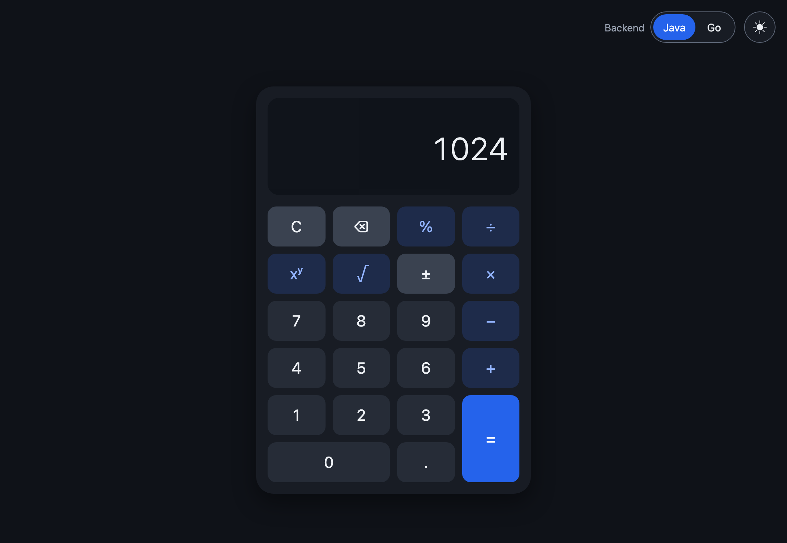
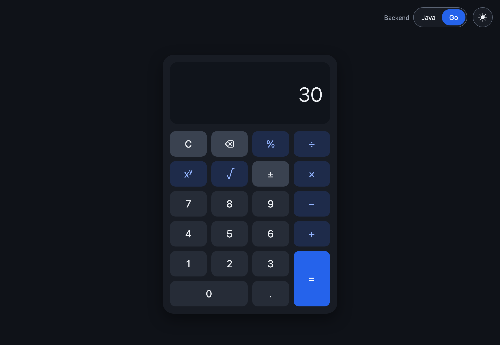
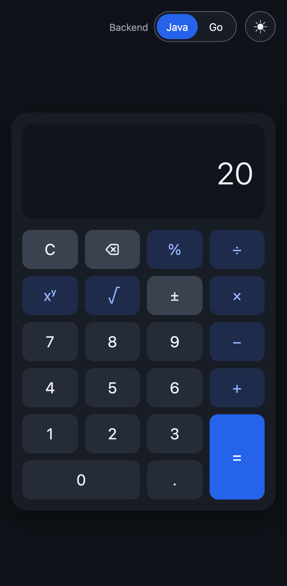

# Sezzle Calculator
AI-ENGINEERING-MANAGED

## Overview

Full-stack calculator: a React + TypeScript SPA that delegates every arithmetic operation to a REST microservice. There are **two interchangeable backends** that implement the same contract byte for byte:

- **Java 21 + Spring Boot 4** (hexagonal), the default.
- **Go 1.27**, standard library only (same hexagonal design).

> **Status:** all 7 operations work end to end (UI → REST API → domain), built with TDD: `add`, `subtract`, `multiply`, `divide`, plus the optional `power` (xʸ), `sqrt` (√) and `percentage` (%). Both backends pass the same 80-case parity contract.

The calculator works like a physical one: operations chain left to right (`2 + 3 × 4 = 20`, `2 xʸ 3 × 2 = 16`), `√` applies immediately to the number on screen (`2 + 9 √ =` → `5`), `%` means "a percent of b" (`20 % 150 =` → `30`), and `±` negates.

- **Keypad:** 4 × 6, 22 buttons, all visible — no "more functions" menu. The 7 operation keys share one color; `C`, `⌫` and `±` share another; `=` spans two rows.
- **Keyboard:** `0-9`, `.`/`,`, `+ - * /`, `^` or `y` (xʸ), `@` (√), `%`, `Enter`/`=`, `Esc`, `Backspace`, `F9` (±), paste. On layouts where `@`, `^` or `%` need AltGr or Option (e.g. Spanish), those combinations work too; other Ctrl/Alt/Cmd shortcuts are left to the browser.
- **Backend selector:** `Backend [ Java | Go ]` at the top right. Java is selected on every load; switching takes effect on the next calculation, without reloading.
- **Health fallback:** on load the app checks both backends. If one is down, the selector is hidden and the healthy one is used silently; while degraded it re-checks every 10 s and restores the selector (and Java, unless you chose Go) when both are back. If a calculation fails because its backend is unavailable (network error, 5xx, or no answer within 10 s — nginx gives up on a stopped backend after 2 s), it is retried once on the other one; 4xx contract errors are never retried.
- **Theme:** dark by default; the ☀/☾ button at the top right switches to light and the choice is remembered in the browser.

### Screenshots

| Dark theme · power on Java | Light theme · square root |
|---|---|
|  |  |
| **Go backend selected · percentage** | **Error handling · division by zero** |
|  |  |

| Mobile · dark | Mobile · light |
|---|---|
|  |  |

## Getting started

### Prerequisites

| Tool | Version |
|------|---------|
| JDK | 21 |
| Maven | 3.9+ |
| Go | 1.27 (`go.mod` requests it; an older Go downloads it automatically) |
| Node.js | 22 LTS (`.nvmrc` — use `fnm` or `nvm`) |
| Docker + Compose | for `docker compose up`, `make up` and `make e2e` |

### Setup

```bash
make install          # frontend + e2e dependencies, Playwright browsers
cp .env.example .env  # optional: override ports
```

### Running

**Everything in Docker (frontend + Java + Go):**

```bash
docker compose up --build
```

| Service | URL |
|---------|-----|
| App (nginx: SPA + API proxy) | http://localhost:3000 |
| Java backend · Swagger UI | http://localhost:8090/swagger-ui.html |
| Go backend · Swagger UI | http://localhost:8091/swagger-ui.html |

`web` starts even if a backend is down; the app then uses the healthy one.

**If a port is busy**, use `make up` instead: it checks `3000`, `8090` and `8091` (or the values in `.env`), moves to the next free port when one is taken by another process (ports already held by the same service of this project are reused), starts the stack detached and prints the real URLs — even if a backend fails to become healthy, in which case it names it and exits non-zero. `make down` stops it.

> **Upgrading from a version before the Go backend:** the Java service was renamed from `backend` to `backend-java`. Run `make down` (or `docker compose down --remove-orphans`) once, so the old `backend` container releases port 8090. `make run` and `make up` already pass `--remove-orphans`. Older settings keep working: `BACKEND_PORT` and `VITE_API_PROXY_TARGET` are still read as deprecated aliases of `BACKEND_JAVA_PORT` and `VITE_JAVA_TARGET`, the Java container still answers to the host name `backend` inside the compose network, and `/api/v1/calculate` still goes to Java.

**Locally, without Docker:**

| Command | What it does | URL |
|---------|--------------|-----|
| `make run-backend` | Java backend | http://localhost:8090 |
| `make run-go` | Go backend | http://localhost:8091 |
| `make run-frontend` | Vite dev server; proxies `/api/java` → `:8090` and `/api/go` → `:8091` | http://localhost:5180 |

| Variable | Default | Used by |
|----------|---------|---------|
| `WEB_PORT` | `3000` | Host port of `web` |
| `BACKEND_JAVA_PORT` | `8090` | Host port of `backend-java` |
| `BACKEND_GO_PORT` | `8091` | Host port of `backend-go` |
| `VITE_PORT` | `5180` | Vite dev server |
| `VITE_JAVA_TARGET` / `VITE_GO_TARGET` | `http://localhost:8090` / `:8091` | Vite dev proxy |

> Go commands in the Makefile set `GO111MODULE=on`, because some machines have module mode disabled globally.

## Architecture

### Repository layout

```
backend/     Java 21 · Spring Boot 4.1 · Maven — hexagonal microservice (default backend)
backend-go/  Go 1.27 · standard library — same hexagon: decimal, domain, app, httpapi
contract/    Shared contract: 80 parity cases + OpenAPI document, run against both backends
frontend/    React 19 · TypeScript 6 · Vite 8 — feature-based + atomic UI, nginx config
e2e/         Playwright suite against the dockerized stack (UI, API contract, Java == Go parity)
scripts/     up.sh / down.sh (free-port startup)
.ai/         Architecture, conventions, testing strategy, ADRs and diagrams
docs/        Screenshots
```

### Routing

The browser only talks to its own origin; nginx (Docker) or Vite (dev) forwards by prefix:

| Browser path | Goes to |
|--------------|---------|
| `/api/java/v1/calculate` | `backend-java` → `/api/v1/calculate` |
| `/api/go/v1/calculate` | `backend-go` → `/api/v1/calculate` |
| `/api/java/health`, `/api/go/health` | each backend's `/actuator/health` |
| `/api/v1/calculate` | Java (kept for compatibility) |

The frontend builds these URLs in exactly one place (`calculatorApi.ts`). nginx resolves backend names per request, so a stopped backend only makes its own routes fail (502) instead of taking the proxy down.

### API

> Contract defined in ADR-001, ADR-002 and ADR-003, implemented identically by both backends (ADR-004). It is enforced by [`contract/`](contract/README.md): the same 80 cases run against Java, against Go, and against both through nginx.

```http
POST /api/v1/calculate
Content-Type: application/json

{ "operation": "divide", "operands": [1, 3] }
```

```json
200 OK
{ "operation": "divide", "result": "0.3333333333" }
```

```json
400 Bad Request — application/problem+json
{ "detail": "division by zero", "instance": "/api/v1/calculate", "status": 400, "title": "Division by zero" }
```

| `operation` | `operands` | Result |
|-------------|------------|--------|
| `add`, `subtract`, `multiply` | `[a, b]` | Exact |
| `divide` | `[a, b]` | Scale 10, `HALF_EVEN` (`1 / 3` → `"0.3333333333"`) |
| `power` | `[base, exponent]` | Exponent must be an integer in [−1000, 1000]; scale 10, `HALF_EVEN` (`2 ^ -3` → `"0.125"`); at most 100 integer digits |
| `sqrt` | `[a]` | `a ≥ 0`; scale 10, `HALF_EVEN` (`√2` → `"1.4142135624"`) |
| `percentage` | `[a, b]` | a % of b = `a × b / 100`, exact (`[20, 150]` → `"30"`) |

- `operation` is lowercase, exact match.
- `operands` are **JSON numbers**. Each must have ≤ 15 significant digits, absolute value < 10^15 and ≤ 10 decimal places. These limits keep every number exactly representable in the browser and bound the cost of a request; `power` additionally estimates the result size before computing, so `999999999999999 ^ 1000` is rejected without being calculated.
- `result` is a **decimal string** computed with exact decimal arithmetic (`BigDecimal` in Java, a `math/big`-based decimal in Go): `0.1 + 0.2` returns `"0.3"`, with no scientific notation and no trailing zeros.
- Strict contract: unknown fields, strings as numbers (`"1"`) and non-string operations are rejected.

Errors follow RFC 9457 (ProblemDetail). `type` is omitted, which is equivalent to `about:blank`. The `title` values are stable and part of the contract; `detail` is free English text. When a request breaks several rules, the first failing check wins: shape → operation → operand count → operand range → operation-specific validity (`Invalid operand`, exponent range, `Result out of range`) → calculation.

| `title` | Status | When |
|---------|--------|------|
| `Malformed request` | 400 | Invalid JSON, missing or `null` field, wrong type, unknown field |
| `Unsupported operation` | 400 | Unknown `operation` (including `"ADD"`) |
| `Invalid operand count` | 400 | Wrong number of operands for the operation (1 for `sqrt`, 2 for the rest) |
| `Operand out of range` | 400 | An operand breaks a limit, or a `power` exponent is outside [−1000, 1000] (`detail` names it, e.g. `operands[1] has more than 10 decimal places`) |
| `Invalid operand` | 400 | `sqrt` of a negative number, or a non-integer `power` exponent |
| `Result out of range` | 400 | A `power` result would exceed 100 integer digits |
| `Division by zero` | 400 | Divisor is zero (including `0 ^ -1`) |
| `Internal error` | 500 | Unexpected failure (no internals exposed) |

Interactive docs: Swagger UI on each backend (`:8090` Java, `:8091` Go — both serve the same OpenAPI document, titled "Sezzle Calculator API" `v1`, at `/v3/api-docs`) · Health: `GET /actuator/health` on each backend.

### Design decisions

- **Hexagonal backends** — the domain is plain code with no framework imports, so the Go port reproduces the same layers (`domain`, `app`, `httpapi`).
- **Single generic endpoint** — new operations extend an enum (Java) or an operation table (Go) instead of adding routes; the contract stays stable across backends.
- **Strategy implemented with an enum** — each `Operation` carries its own `apply`, `arity` and `validate`, so adding operations meant new entries, not new routes or `switch` statements.
- **Exact decimals + string results** — exact decimal arithmetic end to end; JSON numbers would be coerced to IEEE-754 doubles in the browser.
- **Operand limits enforced in both layers** — the domain `Operand` validates and normalizes every input, so a short request like `[1e999999999, 0.1]` or `[0e-999999, 1]` cannot force a huge computation. The UI applies the same limits while typing.
- **Parity as an executable contract** — Java is the reference; `contract/parity-cases.json` (80 cases, compared byte for byte) and `contract/openapi.json` are checked by Java tests, Go tests and E2E. Go uses only the standard library, including its own decimal package that mirrors `BigDecimal` rounding.
- **Prefix routing + health fallback** — `/api/java` and `/api/go` keep the browser on one origin (no CORS); the frontend centralizes backend choice, health checks and a single silent retry.
- **Pure reducer state machine in the UI** — all calculator behavior (chaining, sign, paste, errors, limits) lives in a framework-free reducer that is unit tested without the DOM.
- **Feature-based + atomic UI** — features at the top level, atoms/molecules/organisms inside each feature.
- **Theme via CSS variables** — every color is a token defined for dark and light; an inline script in `index.html` applies the saved theme before React mounts, so there is no flash on load.

Full rationale and discarded alternatives: [ADR-001](.ai/decisions/ADR-001-stack-selection.md) (stack), [ADR-002](.ai/decisions/ADR-002-operaciones-basicas-contrato-y-modelo.md) (basic operations: model, limits, strict contract), [ADR-003](.ai/decisions/ADR-003-operaciones-opcionales-strategy-y-teclado.md) (optional operations, 4×6 keypad, theme) and [ADR-004](.ai/decisions/ADR-004-backend-go-paridad-y-seleccion.md) (Go backend, parity contract, routing, fallback; includes the list of known transport-level deviations).

### Adding an operation (keeping both backends in parity)

1. Add it to the Java `Operation` enum and to the Go operation table (`backend-go/internal/domain`), with the same arity, validation and messages.
2. Add parity cases to `contract/parity-cases.json`, taking `expected` from the real Java response, and regenerate `contract/openapi.json` — see [`contract/README.md`](contract/README.md).
3. Add the key to the frontend keypad and reducer if it needs a button.
4. `make test`, `make coverage` and `make e2e` must all pass; the parity suite fails if the two backends disagree on a single byte.

## Development

| Command | Purpose |
|---------|---------|
| `make lint` | Spotless (Palantir Java Format) + `gofmt`/`go vet` + ESLint + Prettier |
| `make lint-go` | Go only |
| `make format` | Apply Spotless and Prettier |
| `make build` | Java jar + Go binary + frontend production bundle |
| `cd frontend && npm run test:watch` | Frontend TDD loop |

Commits follow [Conventional Commits](https://www.conventionalcommits.org/).

## Testing

| Command | Scope |
|---------|-------|
| `make test` | Unit tests (Java + Go + frontend) |
| `make test-go` | Go unit and contract tests |
| `make coverage` | Unit + integration tests with a **90%** coverage gate on each code base |
| `make e2e` | Playwright (Chromium, Firefox, WebKit, mobile) against an isolated Docker stack with all three services on an ephemeral port — UI, API contract and Java == Go parity |

Coverage reports: `backend/target/site/jacoco/index.html`, `frontend/coverage/index.html`, and `go tool cover -html=backend-go/cover.out` for Go.

## Documentation

- [`.ai/architecture.md`](.ai/architecture.md) — modules, contract, networking
- [`.ai/conventions.md`](.ai/conventions.md) — code style and naming
- [`.ai/testing.md`](.ai/testing.md) — test strategy and required cases
- [`.ai/guardrails.md`](.ai/guardrails.md) — blocking / required / guidance rules
- [`.ai/decisions/`](.ai/decisions/) — architecture decision records
- [`.ai/diagrams/`](.ai/diagrams/) — architecture and data-flow diagrams (Mermaid source + PNG)
- [`contract/README.md`](contract/README.md) — the shared parity contract

## Integrations

- **GitHub Actions** (`.github/workflows/ci.yml`) on every push to `main` and every pull request:
  - `backend`: Java `mvn verify` (unit, integration and contract tests, coverage gate, Spotless);
  - `backend-go`: `gofmt`, `go vet`, `go test -race` with a 90% coverage gate, build;
  - `frontend`: lint, coverage, build;
  - `e2e`: Playwright against the three-service stack.

No external runtime services (databases, caches, third-party APIs). Go's Swagger UI loads `swagger-ui-dist` from a CDN with Subresource Integrity.

## Guardrails

- The `POST /api/v1/calculate` contract does not change without a new ADR, and any change is made in Java, Go and `contract/` together.
- Arithmetic uses exact decimals only; `result` is always a decimal string.
- 90% line and branch coverage gate on every code base; TDD for every behavior change.

Full list: [`.ai/guardrails.md`](.ai/guardrails.md).
