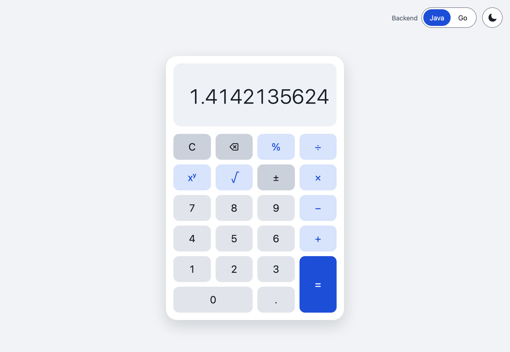
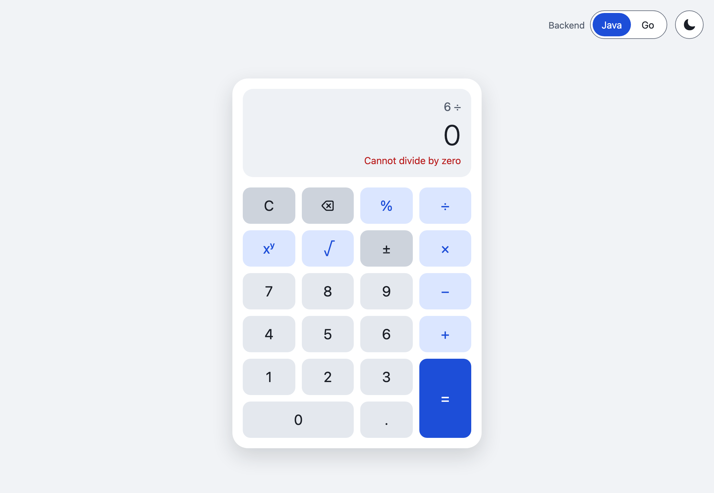
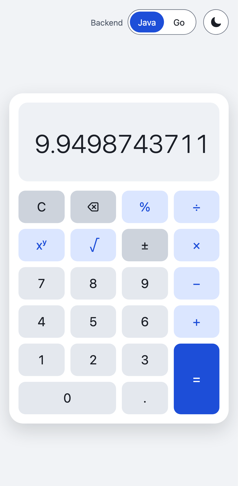
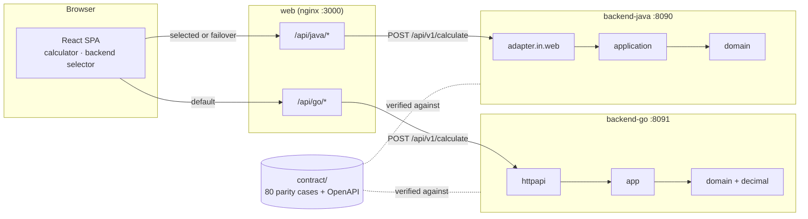

# Sezzle Calculator
AI-ENGINEERING-MANAGED

## Overview

A full-stack calculator: a React + TypeScript single-page app that sends every operation to a REST microservice and shows the result.

The backend is implemented **twice, behind one API contract**:

- **Go** (`backend/go`), the default backend. It uses only the standard library, as the assignment prefers Go.
- **Java** (`backend/java`), Spring Boot 4. Java is the backend language I have the most experience with, so I wrote it as an additional implementation.

Both answer the same requests with byte-identical responses. A shared suite of 80 contract cases enforces this against each backend and against both through the proxy. The UI lets you switch backend at runtime (`Backend [ Go | Java ]`, top right) without reloading.

**Operations:** `add`, `subtract`, `multiply`, `divide`, plus the optional `power` (xʸ), `sqrt` (√) and `percentage` (%). All seven work end to end on both backends.

### Quick start for reviewers

```bash
git clone https://github.com/pabloandresgallardo/sezzle-calculator.git
cd sezzle-calculator
docker compose up --build
```

| What | URL |
|---|---|
| Calculator | http://localhost:3000 |
| Go API · Swagger UI | http://localhost:8091/swagger-ui.html |
| Java API · Swagger UI | http://localhost:8090/swagger-ui.html |

Docker is the only requirement for this path. If a port is busy, run `make up` instead (see [Running with Docker](#running-with-docker)).

### Screenshots

| Dark theme · power | Light theme · square root |
|---|---|
|  |  |
| **Go backend selected · percentage** | **Error handling · division by zero** |
|  |  |

| Mobile · dark | Mobile · light |
|---|---|
|  |  |

> The screenshots were taken before Go became the default, so the selector in them reads `Java | Go`.

### How the calculator behaves

- **Chaining:** operations chain left to right like a physical calculator: `2 + 3 × 4 = 20`, `2 xʸ 3 × 2 = 16`.
- **Square root:** `√` applies immediately to the number on screen: `2 + 9 √ =` gives `5`.
- **Percentage:** `%` means "a percent of b": `20 % 150 =` gives `30`.
- **Sign:** `±` negates the number on screen.
- **Keypad:** 4 × 6 layout with 22 buttons, all visible; there is no "more functions" menu.
- **Physical keyboard:** `0-9`, `.` or `,`, `+ - * /`, `^` or `y` (xʸ), `@` (√), `%`, `Enter` or `=`, `Esc`, `Backspace`, `F9` (±), and paste.
- **Input validation:** the UI applies the API's operand limits before sending anything. Typing stops at 15 significant digits or 10 decimals. Pasted text shows "Invalid number" when it is not a number, or "Too many digits" when it exceeds the limits.
- **Error handling:** API errors become short messages such as "Cannot divide by zero" or "Invalid input". A network failure shows "Service unavailable".
- **Backend selection:** Go is selected on every load, and switching applies from the next calculation.
  - On load the app checks both backends' health. If one is down, the selector hides and the healthy one is used silently; it re-checks every 10 s and restores the selector when both are back.
  - A calculation that fails because its backend is unavailable is retried once on the other backend. This covers a network error, a 5xx, or no answer within 10 s.
  - Contract errors (4xx) are never retried.
- **Theme:** dark by default. The ☀/☾ button switches to light, and the choice is remembered in the browser.
- **Responsive:** the layout works down to 360 px. An E2E test runs at that width and checks that the toggle stays inside the viewport and that there is no horizontal scroll.

## Getting started

### Prerequisites

| Tool | Version | Needed for |
|---|---|---|
| Docker + Compose | any recent | `docker compose up`, `make up`, `make e2e` |
| Go | 1.27 (`go.mod`; an older Go downloads 1.27 automatically) | running or testing the Go backend locally |
| JDK + Maven | 21 + 3.9 | running or testing the Java backend locally |
| Node.js | 22 LTS (`.nvmrc`; use `fnm` or `nvm`) | running or testing the frontend and E2E locally |

### Setup

```bash
git clone https://github.com/pabloandresgallardo/sezzle-calculator.git
cd sezzle-calculator
make install          # npm ci for frontend and e2e, Playwright browsers
cp .env.example .env  # optional: only to change ports
```

The backends need no install step: Go uses only the standard library, and Maven downloads its dependencies on the first run.

### Running with Docker

```bash
docker compose up --build
```

This starts three services. The browser only ever talks to `web` (nginx), which serves the SPA and proxies `/api/go/*` and `/api/java/*` to the backends, so there is no CORS.

| Service | Host port | Health |
|---|---|---|
| `web`: nginx serving the SPA and the API proxy | 3000 | — |
| `backend-go` | 8091 | `GET /actuator/health` |
| `backend-java` | 8090 | `GET /actuator/health` |

- **Busy ports:** `make up` starts the same stack detached. When one of the ports is already taken, it moves to the next free port and prints the real URLs. `make down` stops it.
- **One backend down:** `web` starts even if a backend is unhealthy, and the app falls back to the healthy one.

### Running each part without Docker

Each part runs on its own. Start one or both backends, then the frontend:

| Part | Command | URL |
|---|---|---|
| Go backend | `make run-go` (same as `cd backend/go && go run ./cmd/server`) | http://localhost:8091 |
| Java backend | `make run-java` (same as `cd backend/java && mvn spring-boot:run`) | http://localhost:8090 |
| Frontend (Vite dev server) | `make run-frontend` (same as `cd frontend && npm run dev`) | http://localhost:5180 |

- **Proxy:** the dev server proxies `/api/go` to `:8091` and `/api/java` to `:8090`.
- **One backend only:** with only one backend running, the app detects the other is down and uses the running one.
- **Host-wide `GO111MODULE`:** the Makefile sets `GO111MODULE=on`, because some machines disable module mode globally. If you call `go` directly on such a machine, set it yourself.

| Variable | Default | Used by |
|---|---|---|
| `PORT` | `8091` | Go backend |
| `SERVER_PORT` | `8090` | Java backend |
| `VITE_PORT` | `5180` | Vite dev server |
| `VITE_GO_TARGET` / `VITE_JAVA_TARGET` | `http://localhost:8091` / `http://localhost:8090` | Vite dev proxy |
| `WEB_PORT`, `BACKEND_GO_PORT`, `BACKEND_JAVA_PORT` | `3000`, `8091`, `8090` | host ports in Docker Compose |

> **Upgrading from an older clone:**
> - **Renamed service:** the Java service was renamed from `backend` to `backend-java`. Run `docker compose down --remove-orphans` once; `make up` and `make run` already pass `--remove-orphans`.
> - **Old names still work:** `BACKEND_PORT` and `VITE_API_PROXY_TARGET` are read as deprecated aliases, the host name `backend` still reaches Java inside the compose network, and `/api/v1/calculate` through the proxy still goes to Java.

### Swagger / OpenAPI

Each backend serves Swagger UI and the same OpenAPI 3 document (`contract/openapi.json`, titled "Sezzle Calculator API" `v1`):

| Backend | Swagger UI | OpenAPI JSON |
|---|---|---|
| Go | http://localhost:8091/swagger-ui.html | http://localhost:8091/v3/api-docs |
| Java | http://localhost:8090/swagger-ui.html | http://localhost:8090/v3/api-docs |

Tests keep the two documents identical:

- Java's `OpenApiContractIT` checks that springdoc generates exactly `contract/openapi.json`.
- Go embeds a byte-exact copy of that file, and a Go test checks that the copy has not drifted.

## Architecture



Both backends use the same **hexagonal** layering: the domain is plain code with no framework imports, an application layer applies the validation order, and the HTTP adapter only maps JSON to commands and errors to responses. The frontend never knows which language answered: it only changes the URL prefix, and it builds that URL in a single place (`frontend/src/features/calculator/api/calculatorApi.ts`).

### Repository layout

```
backend/
  go/        Go 1.27, standard library only (default backend)
             internal/decimal  exact decimal arithmetic on math/big (BigDecimal semantics)
             internal/domain   operations, operand limits, typed errors
             internal/app      Calculate use case (validation order)
             internal/httpapi  router, strict JSON decoder, ProblemDetail, health, OpenAPI + Swagger UI
             cmd/server        entry point, graceful shutdown, -healthcheck flag
  java/      Java 21, Spring Boot 4.1, Maven
             domain.model / domain.exception     Operation enum (Strategy), Operand, errors
             application.port.in / .service      CalculateUseCase, CalculatorService
             adapter.in.web                      controller, DTOs (records), ProblemDetail handler
             config                              strict Jackson, OpenAPI
frontend/    React 19, TypeScript 6, Vite 8; feature-based with atomic UI inside each feature
             src/features/calculator  atoms, molecules, organisms, hooks, model (pure reducer), api
             src/shared/backend       backend selector, health checks, failover
             src/shared/theme         dark/light tokens and toggle
contract/    parity-cases.json (80 cases) + openapi.json, shared by both backends
e2e/         Playwright suite against the Docker stack
scripts/     up.sh / down.sh (free-port startup)
docs/        screenshots, coverage report
.ai/         architecture, conventions, testing strategy, guardrails, ADRs, specs, plans, diagrams
```

### Technology stack

| Layer | Technology |
|---|---|
| Frontend | React 19.3, TypeScript 6.0 (strict), Vite 8, CSS Modules, nginx 1.29 in Docker |
| Go backend | Go 1.27, standard library only (`net/http`, `math/big`, `encoding/json`), distroless image |
| Java backend | Java 21, Spring Boot 4.1.2, Jackson 3, springdoc-openapi 3.2.0, Lombok, Maven |
| Tests | Go `testing` (+ `-race`), JUnit 5 + Spring Boot Test (MockMvc), Vitest 5 + Testing Library 16 + MSW 3, Playwright 1.65 |
| Quality | `gofmt` + `go vet`, Spotless (Palantir Java Format), ESLint + Prettier, JaCoCo, 90% coverage gates |
| Delivery | Docker Compose, GitHub Actions |

### API

One endpoint, the same on both backends:

```http
POST /api/v1/calculate
Content-Type: application/json

{ "operation": "<name>", "operands": [<number>, ...] }
```

| `operation` | `operands` | Result |
|---|---|---|
| `add`, `subtract`, `multiply` | `[a, b]` | exact |
| `divide` | `[a, b]` | 10 decimal places, banker's rounding (`HALF_EVEN`) |
| `power` | `[base, exponent]` | exponent is an integer in [−1000, 1000]; 10 decimals, `HALF_EVEN`; at most 100 integer digits |
| `sqrt` | `[a]` | `a ≥ 0`; 10 decimals, `HALF_EVEN` |
| `percentage` | `[a, b]` | a % of b = `a × b / 100`, exact |

The examples below were run against both backends; the responses are identical. Replace `8091` (Go) with `8090` (Java), or call through the proxy at `http://localhost:3000/api/go/v1/calculate` or `/api/java/v1/calculate`.

```bash
curl -s -X POST http://localhost:8091/api/v1/calculate \
  -H 'Content-Type: application/json' \
  -d '{"operation":"add","operands":[0.1,0.2]}'
# 200 {"operation":"add","result":"0.3"}

curl -s -X POST http://localhost:8091/api/v1/calculate \
  -H 'Content-Type: application/json' \
  -d '{"operation":"divide","operands":[1,3]}'
# 200 {"operation":"divide","result":"0.3333333333"}

curl -s -X POST http://localhost:8091/api/v1/calculate \
  -H 'Content-Type: application/json' \
  -d '{"operation":"sqrt","operands":[2]}'
# 200 {"operation":"sqrt","result":"1.4142135624"}

curl -s -X POST http://localhost:8091/api/v1/calculate \
  -H 'Content-Type: application/json' \
  -d '{"operation":"power","operands":[2,10]}'
# 200 {"operation":"power","result":"1024"}

curl -s -X POST http://localhost:8091/api/v1/calculate \
  -H 'Content-Type: application/json' \
  -d '{"operation":"percentage","operands":[20,150]}'
# 200 {"operation":"percentage","result":"30"}
```

Errors are `400` (or `500`) with `Content-Type: application/problem+json` (RFC 9457):

```bash
curl -s -X POST http://localhost:8091/api/v1/calculate \
  -H 'Content-Type: application/json' \
  -d '{"operation":"divide","operands":[6,0]}'
# 400 {"detail":"division by zero","instance":"/api/v1/calculate","status":400,"title":"Division by zero"}
```

| Request | `title` | `detail` |
|---|---|---|
| `{"operation":"divide","operands":[6,0]}` | `Division by zero` | `division by zero` |
| `{"operation":"sqrt","operands":[-4]}` | `Invalid operand` | `operands[0] must not be negative` |
| `{"operation":"modulo","operands":[1,2]}` | `Unsupported operation` | `unsupported operation: modulo` |
| `{"operation":"add","operands":[1]}` | `Invalid operand count` | `add requires 2 operands, got 1` |
| `{"operation":"add","operands":["1",2]}` | `Malformed request` | `Request body is not valid JSON or does not match the expected shape` |
| `{"operation":"add","operands":[1234567890123456,1]}` | `Operand out of range` | `operands[0] absolute value must be less than 10^15` |
| `{"operation":"power","operands":[10,100]}` | `Result out of range` | `result would exceed 100 integer digits` |

| `title` | Status | When |
|---|---|---|
| `Malformed request` | 400 | invalid JSON, missing or `null` field, wrong type (a string where a number goes), unknown field |
| `Unsupported operation` | 400 | unknown `operation`, including `"ADD"` (names are case-sensitive) |
| `Invalid operand count` | 400 | 1 operand for `sqrt`, 2 for the rest |
| `Operand out of range` | 400 | more than 15 significant digits, absolute value ≥ 10^15, more than 10 decimals, or a `power` exponent outside [−1000, 1000] |
| `Invalid operand` | 400 | `sqrt` of a negative number, or a non-integer `power` exponent |
| `Result out of range` | 400 | a `power` result would exceed 100 integer digits |
| `Division by zero` | 400 | divisor is zero, including `0 ^ -1` |
| `Internal error` | 500 | unexpected failure; no internals are exposed |

When a request breaks several rules, the first failing check wins, in this order: shape → operation → operand count → operand limits → operation-specific validity → calculation.

Other endpoints on each backend:
- `GET /actuator/health` returns `{"groups":["liveness","readiness"],"status":"UP"}`.
- `GET /v3/api-docs` returns the OpenAPI document.
- `GET /swagger-ui.html` serves Swagger UI.

### Design decisions

Each decision has an ADR with the alternatives I discarded. The ADRs are written in Spanish; this is the English summary.

- **One generic endpoint** (ADR-001, ADR-002): `POST /api/v1/calculate` with `{operation, operands}`.
  - Adding an operation is a new entry, not a new route.
  - The UI and both backends share one contract.
- **Exact decimals, results as strings** (ADR-002).
  - Arithmetic is exact decimal end to end: `BigDecimal` in Java, a `math/big` decimal type in Go. So `0.1 + 0.2` is `"0.3"`.
  - `result` is a decimal string, because a JSON number would be turned into an IEEE-754 double by the browser.
- **Operand limits in both layers** (ADR-002).
  - The limits are at most 15 significant digits, an absolute value below 10^15, and at most 10 decimals. They keep every number exact in the browser and bound the cost of a request.
  - Operands are normalized first, so a short request like `[1e999999999, 0.1]` cannot force a huge computation.
  - `power` estimates the size of its result before computing it.
- **Strict contract** (ADR-002): unknown fields, strings in place of numbers, and wrong case in `operation` are rejected rather than guessed.
- **Errors as ProblemDetail** (RFC 9457, ADR-002): `title` values are stable and part of the contract; `detail` is short English text.
- **Strategy pattern through the operation table** (ADR-003): each operation carries its own `apply`, arity and validation. That is the `Operation` enum in Java and the operation table in Go, so there are no `switch` statements spread around.
- **Hexagonal backends** (ADR-001): a framework-free domain made the Go port a translation of the same layers, not a redesign.
- **Two backends, one executable contract** (ADR-004).
  - `contract/parity-cases.json` holds 80 cases, taken from real Java responses, with status, content type and exact body.
  - They run in the Go tests, in the Java tests, and through nginx in Playwright, which also checks that Go == Java.
  - Go deliberately uses only the standard library.
- **Prefix routing and silent fallback** (ADR-004).
  - `/api/go` and `/api/java` keep the browser on one origin.
  - nginx resolves backend names per request, so a stopped backend only fails its own routes.
  - The frontend centralizes backend choice, health checks and the single retry.
- **Go by default, folders `backend/go` and `backend/java`** (ADR-005): the assignment prefers Go, so Go is what a reviewer sees first. Java is the behavioral reference for the contract.
- **UI as a pure state machine** (ADR-002, ADR-003).
  - All calculator behavior lives in a framework-free reducer that is unit tested without the DOM: chaining, sign, paste, limits and errors.
  - Components are feature-based, with atoms, molecules and organisms inside each feature.
- **Theme with CSS variables** (ADR-003): every color is a token defined for both themes. An inline script applies the saved theme before React mounts, so the page does not flash.

### Assumptions and limitations

- **Percentage** means "a percent of b" (`20 % 150 = 30`), because the assignment does not define it.
- **The calculator chains left to right** like a physical one, not with operator precedence. `2 + 3 × 4` is `20`. Each binary step is one API call.
- **Rounding:** division, square root and negative powers return 10 decimal places with banker's rounding. Exact results drop trailing zeros (`"2"`, not `"2.0000000000"`).
- **Number limits:** operands are limited as described above. `power` is limited to integer exponents in [−1000, 1000] and results of at most 100 integer digits.
- **Stateless:** there is no database, history or authentication. Nothing in the assignment needs them.
- **Scope:** the assignment suggests 2–4 hours. This repository goes further on purpose, and the extras are:
  - the second backend;
  - the parity contract;
  - the backend selector and failover;
  - the free-port script;
  - the theme.

  The requested core is the React frontend with the Go API, tests, this README and Docker.
- **Transport-level differences:** the two backends differ on a few edge cases that the contract does not cover. Examples are unusual charsets in `Content-Type`, Tomcat's own HTML 400 pages and `TRACE`. They are listed in ADR-004 and never reached by the frontend.

## Development

| Command | Purpose |
|---|---|
| `make lint` | `gofmt` + `go vet`, Spotless (Palantir Java Format), ESLint + Prettier |
| `make format` | apply `gofmt`, Spotless and Prettier |
| `make build` | Go binary, Java jar, frontend production bundle |
| `make test-go`, `make test-java`, `make test-frontend` | one code base at a time |
| `cd frontend && npm run test:watch` | frontend TDD loop |

Commits follow [Conventional Commits](https://www.conventionalcommits.org/).

### Adding an operation (keeping both backends in parity)

1. Add it to the Go operation table (`backend/go/internal/domain`) and to the Java `Operation` enum, with the same arity, validation and messages.
2. Add parity cases to `contract/parity-cases.json`, taking `expected` from the real Java response. Regenerate `contract/openapi.json` (see [`contract/README.md`](contract/README.md)).
3. Add the key to the frontend keypad and reducer if it needs a button.
4. `make test`, `make coverage` and `make e2e` must pass. The parity suites fail if the two backends disagree on a single byte.

## Testing

Every behavior was written test-first (RED → GREEN).

| Layer | What it proves | Where | Count |
|---|---|---|---|
| Go unit | decimal arithmetic and rounding, operand limits, each operation, validation order, strict JSON decoding, error mapping, health, OpenAPI, server startup and shutdown | `backend/go/**/*_test.go` | 89 tests, 659 table-driven subtests, run with `-race` |
| Java unit | domain (`Operation`, `Operand`, power bounds), service, controller slice with MockMvc, error handler | `backend/java/src/test` (`*Test`) | 137 |
| Java integration | the full Spring context over HTTP; the OpenAPI document | `backend/java/src/test` (`*IT`) | 92 (80 of them are the contract cases) |
| Contract (parity) | each backend returns exactly the expected status, content type and body for 80 requests: success, every error title, limits, malformed JSON, wrong methods and paths | `contract/parity-cases.json`, run by Go `TestParityCases`, Java `ContractParityIT` and E2E `parity.spec.ts` | 80 × 3 |
| Frontend unit / component | the pure calculator reducer, API client (timeouts, retryable errors), hooks, components, backend selector (default, keyboard, ARIA), health fallback and failover, theme | `frontend/src/**/*.test.ts(x)`, with MSW faking the API | 344 |
| E2E (Playwright) | the real stack in Docker: every operation by mouse and keyboard, error messages, edge cases, theme, 360 px layout, backend switching and fallback, and API contract and Go == Java parity through nginx | `e2e/tests` | 141 per browser project (Chromium, Firefox, WebKit, mobile Pixel 7) |

```bash
make test       # unit tests: Go, Java, frontend
make coverage   # unit + integration tests with the 90% gates (fails below)
make e2e        # builds an isolated Docker stack on a random port, runs Playwright, tears it down
```

### Coverage

| Code base | Lines / statements | Branches |
|---|---|---|
| Go (`internal/...`) | 98.4% | — |
| Java | 100% | 100% |
| Frontend | 100% | 97.92% |

The breakdown by package and the report locations are in [`docs/coverage.md`](docs/coverage.md). CI uploads the HTML reports as artifacts.

### Continuous integration

GitHub Actions (`.github/workflows/ci.yml`) runs on every pull request and on pushes to `main`:

- `backend-go`: `gofmt`, `go vet`, `go test -race` with the coverage gate, build.
- `backend-java`: `mvn verify`, which runs unit, integration and contract tests, the JaCoCo gate and Spotless.
- `frontend`: lint, tests with coverage, production build.
- `e2e`: Playwright against the three-service Docker stack. It runs after the other three jobs pass.

## Documentation

- [`PROMPTS_USED.md`](PROMPTS_USED.md): every prompt I gave the AI assistant, verbatim and in order, with English translations.
- [`docs/coverage.md`](docs/coverage.md): the coverage report.
- [`contract/README.md`](contract/README.md): the shared parity contract.
- [`.ai/decisions/`](.ai/decisions/): ADR-001 (stack), ADR-002 (basic operations, limits, strict contract), ADR-003 (optional operations, Strategy, keypad, theme), ADR-004 (Go backend, parity, routing, fallback), ADR-005 (`backend/{go,java}` layout, Go by default). Written in Spanish.
- [`.ai/`](.ai/): architecture, conventions, testing strategy, guardrails; the specs and plans of each iteration in `.ai/docs/`; diagrams in `.ai/diagrams/`.

### AI-assisted development

I built this with Claude Code, driven by two custom skills of my own. The AI wrote most of the code; the process, the decisions and the verification are mine.

- **`start-project` (bootstrap and architecture).** It works from the requirement as an interview: one question per decision (stack, architecture, testing strategy, Docker), an advisory review and a design pass with diagrams. Only then does it produce the scaffold, the `.ai/` documentation and ADR-001.
- **`dev-skill` (feature development).** It runs one feature at a time:
  1. Validate the project and its docs.
  2. Classify the change.
  3. Write a spec, then a plan, each needing my approval.
  4. Record an ADR.
  5. Implement with TDD. One subagent per task, each followed by a reviewer.
  6. Update the documentation.
  7. Verify: unit tests, lint, Docker, E2E.
  8. Run a whole-branch review.

It ran three times: basic operations (PR #2), optional operations (PR #3) and the Go backend (PR #4).

Every design fork came back to me as a question with options and a recommendation. Examples are `BigDecimal` vs `double`, how strict the contract is, the keypad layout, how to route between backends, and how Go does decimal arithmetic. Nothing was committed without my review, and I merged every PR. [`PROMPTS_USED.md`](PROMPTS_USED.md) lists all of it: my prompts, my answers to those questions, and the long prompts I pasted. Two of those (the Go backend task and the final audit) I drafted with Claude in separate sessions, and they are marked as such.

## Integrations

- **External services:** none at runtime; no databases, caches or third-party APIs.
- **Swagger UI:**
  - Java serves Swagger UI through springdoc.
  - Go's Swagger UI page loads `swagger-ui-dist` from the unpkg CDN with Subresource Integrity.
- **CI:** GitHub Actions; see [Continuous integration](#continuous-integration).

## Guardrails

- **Contract changes:** `POST /api/v1/calculate` does not change without a new ADR. Any change is made in Go, Java and `contract/` together.
- **Arithmetic:** exact decimals only; `result` is always a decimal string.
- **Tests:** a 90% coverage gate on every code base, and TDD for every behavior change.

Full list: [`.ai/guardrails.md`](.ai/guardrails.md).
